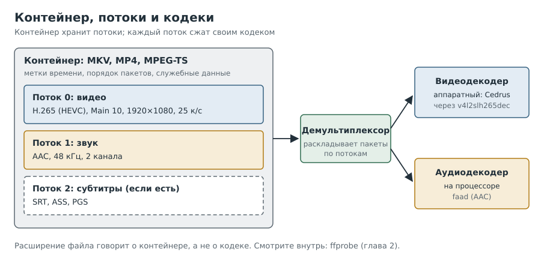

# Глава 1. Кодеки, контейнеры и потоки

Прежде чем просить плату что-то декодировать, нужно договориться о словах. Почти вся
путаница в разговорах о видео происходит оттого, что «формат файла», «кодек» и
«профиль» смешивают в одно. В этой главе мы их разделим.

---

## Рецепт 1.1. Отличить контейнер от кодека

**Задача.** Понять, что означает «у меня фильм в MKV» и почему этого мало, чтобы сказать,
сыграет ли его плата.

**Решение.** Запомнить три уровня:



- **Контейнер** (MKV, MP4, MPEG-TS) это коробка. Он хранит несколько потоков,
  метки времени и служебную информацию. Контейнер ничего не сжимает.
- **Поток** это одна дорожка внутри коробки: видео, звук, субтитры.
- **Кодек** это способ сжатия конкретного потока: H.264, H.265 (HEVC), AV1 для видео,
  AAC, AC-3, Opus для звука.

**Как это работает.** Проигрыватель сначала открывает коробку (это делает
*демультиплексор*), раскладывает пакеты по потокам и отдаёт каждый поток своему
*декодеру*. Аппаратный декодер платы занимается только видео и только определёнными
кодеками. Контейнер ему безразличен, но вот если у демультиплексора что-то пошло не так,
до декодера ничего не дойдёт (в главе 10 мы именно на это наткнёмся).

**Подводные камни.** Файл `.mkv` может содержать H.264, H.265, AV1 или что угодно ещё.
По расширению ничего нельзя сказать о кодеке. Как заглянуть внутрь, показано в
[главе 2](02-inspecting-files.md).

---

## Рецепт 1.2. Понять, чем H.265 отличается от H.264

**Задача.** Решить, зачем вообще нужен H.265 и чем он «тяжелее».

**Решение.** Короткая сводка:

| | H.264 (AVC) | H.265 (HEVC) |
|---|---|---|
| Год стандарта | 2003 | 2013 |
| Размер при том же качестве | 100% | примерно 50–70% (зависит от материала) |
| Блоки кадра | до 16x16 | до 64x64, гибко делятся |
| 10 бит на канал | есть, но аппаратно почти не поддерживается | профиль Main 10, широко поддерживается |
| HDR | на практике нет | да (HDR10, HLG) |
| Сложность декодирования | ниже | выше |

**Как это работает.** H.265 умнее предсказывает, что будет в следующей части кадра и в
следующем кадре. Файл получается меньше, но декодеру приходится больше считать. Поэтому
старая Raspberry Pi 3 тянет H.264 1080p (у неё есть для него блок в железе), а H.265
процессором не вытягивает: такого блока у неё нет.

**Подводные камни.** Числа выигрыша по размеру сильно зависят от кодировщика и материала.
Не верьте одной цифре из рекламы.

---

## Рецепт 1.3. Не путать декодирование и перекодирование

**Задача.** Понять, сможет ли плата «пережать» фильм.

**Решение.** Разделить два процесса:

- **Декодирование:** сжатый поток → кадры. Это нужно проигрывателю.
- **Перекодирование (транскодирование):** сжатый поток → кадры → *снова сжатый поток*
  другим кодеком. Это декодер плюс **кодировщик**, и тяжёлая часть именно кодировщик.

У H616 по спецификации есть аппаратный кодировщик только для H.264, а драйвер Cedrus в
основном ядре кодирования вообще не поддерживает. Значит, перекодировать в H.265 плата
может только процессором, то есть очень медленно. Её работа это проигрывать, а не пережимать.

**Как проверить, что умеет видеокарта сервера.** Если сервер собирается перекодировать,
спросите его драйвер. На AMD и Intel это делает утилита `vainfo`. В Jellyfin-контейнере
она лежит рядом с его ffmpeg:

```
[сервер]
docker exec jellyfin /usr/lib/jellyfin-ffmpeg/vainfo --display drm --device /dev/dri/renderD128
```

**Как это работает.** Каждая строка вывода это пара «профиль: точка входа».
`VAEntrypointVLD` значит «умеет декодировать», `VAEntrypointEncSlice` значит «умеет
кодировать». У Radeon RX 6700 XT на стенде это выглядело так:

```
VAProfileHEVCMain               : VAEntrypointVLD
VAProfileHEVCMain               : VAEntrypointEncSlice
VAProfileHEVCMain10             : VAEntrypointVLD
VAProfileHEVCMain10             : VAEntrypointEncSlice
VAProfileAV1Profile0            : VAEntrypointVLD
```

То есть HEVC (8 и 10 бит) карта кодирует и декодирует, а AV1 только декодирует.

**Подводные камни.** Галочка «Allow encoding in HEVC format» в Jellyfin говорит не о том,
*умеет* ли карта, а о том, *разрешено* ли Jellyfin отдавать клиентам HEVC при
перекодировании на лету. Если у вас есть клиенты без HEVC (та же Pi 3), её разумно
держать выключенной.

---

## Рецепт 1.4. Прочитать профиль и разрядность

**Задача.** Понять, что значат «Main 10», «yuv420p10le» и «4:2:0».

**Решение.**

- **Профиль** это набор разрешённых инструментов сжатия. Для H.265 главные: `Main`
  (8 бит) и `Main 10` (10 бит).
- **Разрядность:** 8 бит дают 256 оттенков на канал, 10 бит дают 1024. Разница видна на
  плавных градиентах (небо, тени) в виде «полосок» на 8 битах.
- **Субдискретизация цвета** `4:2:0`: цветовая информация хранится в четыре раза
  реже, чем яркость. Это стандарт для фильмов.
- **Формат пикселей** в ffmpeg объединяет всё это: `yuv420p` значит 8 бит, 4:2:0;
  `yuv420p10le` значит 10 бит, 4:2:0.

**Подводные камни.** Название файла не доказательство. На стенде файл с «main10» в имени
оказался обычным 8-битным `Main`, и мы полдня рассуждали о «10 битах, показанных как 8».
Профиль всегда проверяйте инструментом (рецепт 2.2), а не по имени и не по описанию на сайте.

---

## Рецепт 1.5. Понять цветовые метки и почему «цвета немного не те»

**Задача.** Разобраться, почему одинаковый файл может выглядеть по-разному.

**Решение.** В потоке H.264/H.265 есть необязательные метки:

| Метка | Что задаёт | Типичные значения |
|---|---|---|
| Матрица (matrix) | Как превращать YUV в RGB | BT.601 (SD), BT.709 (HD), BT.2020 (UHD/HDR) |
| Передаточная функция (transfer) | Гамма | BT.709, PQ (HDR10), HLG |
| Первичные цвета (primaries) | Цветовой охват | BT.709, BT.470BG, BT.2020 |
| Диапазон (range) | Полный (0–255) или ограниченный (16–235) | обычно ограниченный |

Если меток нет или они неверны, проигрыватель угадывает. Ошибка матрицы (601 вместо 709)
даёт лёгкий сдвиг красных и зелёных; ошибка диапазона даёт «вылинявшую» или «пережжённую»
картинку; HDR без HDR-обработки выглядит тускло и серо.

**Подводные камни.** Метки вычисляет разборщик потока, а применяет тот, кто превращает YUV
в RGB. На нашем стенде это композитор Wayland, и он метки из GStreamer не получает (мы это
не проверяли досконально, но так устроен путь). Поэтому сравнивать цвета честно можно
только с эталонным проигрывателем на другом устройстве.

---

## Частые вопросы про кодеки

**Почему бы сразу не перейти на AV1?** AV1 сжимает ещё лучше H.265 и не требует
лицензионных отчислений. Но аппаратный декодер AV1 есть только у новых чипов. У H616 его
нет, и такие файлы плата будет декодировать процессором.

**А VP9?** Производитель заявляет VP9 для H616, но в основном драйвере Cedrus поддержки
VP9 нет: на стенде контроллы VP9 у устройства отсутствуют. Ждать стоит только того, что
видно в `v4l2-ctl` (рецепт 5.3).

**Если декодер «умеет 4K», значит ли это, что 4K заработает?** Нет. Нужны ещё память под
кадры (кадр 4K в четыре раза тяжелее 1080p, см. главу 9), путь на экран и HDMI нужного
режима. Мы 4K не проверяли.

**Зачем вообще 10 бит, если экран 8-битный?** Кодировщику проще сжимать градиенты без
полос, поэтому 10-битные файлы бывают и меньше, и чище даже при 8-битном выводе.

**Аппаратный кодировщик видеокарты хуже программного?** Обычно при том же битрейте
программный `x265` даёт лучшее качество или меньший файл, а аппаратный выигрывает
скоростью. Это общее знание, на стенде мы его не измеряли.

---

## Вопросы для самопроверки

1. Файл называется `film.mkv`. Что можно сказать о кодеке видео?
2. Чем отличается транскодирование от декодирования, и какая его часть тяжелее?
3. Что означают `VAEntrypointVLD` и `VAEntrypointEncSlice`?
4. В названии файла написано «main10». Что нужно сделать, прежде чем в это верить?
5. Почему ошибка матрицы цветов даёт лишь «немного не те» цвета, а HDR без обработки
   выглядит совсем не так?

## Где почитать

- [High Efficiency Video Coding — Wikipedia](https://en.wikipedia.org/wiki/High_Efficiency_Video_Coding)
- [Документация ffprobe](https://ffmpeg.org/ffprobe.html)
- [Аппаратное ускорение в Jellyfin](https://jellyfin.org/docs/general/post-install/transcoding/hardware-acceleration/)

---

Назад: [Предисловие](00-preface.md) | Далее: [Глава 2. Смотрим внутрь файла](02-inspecting-files.md)
