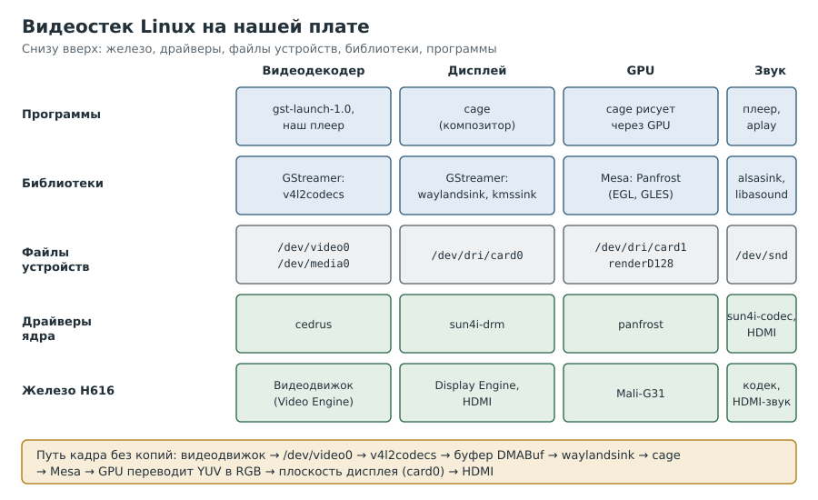
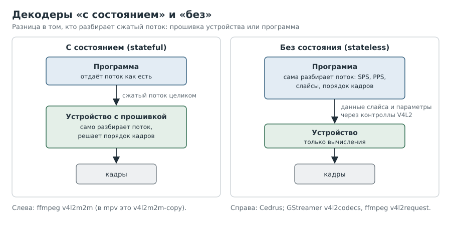

# Глава 5. `/dev`, драйверы и видит ли ядро декодер

Это первая глава, где мы говорим с железом. Новичку она даст карту местности, опытному
набор команд, которыми за минуту отвечают на вопрос «есть ли у меня аппаратный декодер».

---

## Рецепт 5.1. Понять, что такое файл устройства

**Задача.** Разобраться, что такое `/dev/video0` и почему с ним работают как с файлом.

**Решение.**

```
[плата]
ls -l /dev/video* /dev/media* /dev/dri/*
id
```

Пример:

```
crw-rw---- 1 root video 81, 0 /dev/video0
crw-rw---- 1 root video 248, 0 /dev/media0
```

**Как это работает.** Буква `c` в начале означает *символьное устройство*: это не файл на
диске, а «дверь» в драйвер ядра. Программа открывает её, как файл, и общается с драйвером
через вызовы `ioctl`. Пара чисел `81, 0` это старший и младший номера: по старшему ядро
понимает, какой драйвер отвечает.

Права `crw-rw----` и группа `video` означают, что открыть дверь могут root и члены группы
`video`. Команда `id` покажет, состоите ли вы в ней (мастер Armbian добавил нашего
пользователя в `video` и `render` сам).

Сразу полезно знать, кто есть кто в видео:

| Устройство | Что за ним стоит |
|---|---|
| `/dev/video0` | Видеоустройство V4L2: у нас аппаратный декодер |
| `/dev/media0` | Медиа-контроллер: описание связей внутри видеоустройства |
| `/dev/dri/card0` | Дисплейный контроллер (у нас HDMI) |
| `/dev/dri/card1`, `renderD128` | Графический процессор (у нас Mali, драйвер Panfrost) |
| `/dev/snd/*` | Звуковые карты |



---

## Рецепт 5.2. Узнать, видит ли ядро аппаратный декодер

**Задача.** Ответить «да» или «нет» без установки чего-либо.

**Решение.**

```
[плата]
ls -l /dev/video* /dev/media*
lsmod | grep -i cedrus
sudo dmesg | grep -i -E 'cedrus|video.engine'
ls /proc/device-tree/soc/ | grep -i video
```

Ответ стенда:

```
/dev/media0  /dev/video0
(lsmod пусто)
[    1.680487] cedrus 1c0e000.video-codec: Device registered as /dev/video0
video-codec@1c0e000
```

**Как это работает.** Четыре команды проверяют четыре уровня:

1. **Описание платы** (`/proc/device-tree`): ядро знает, что на кристалле есть видеоблок.
2. **Драйвер** (`dmesg`): драйвер Cedrus нашёл блок и зарегистрировался.
3. **Модуль или встроен** (`lsmod`): пусто, но запись в `dmesg` на 1,68 секунде загрузки
   говорит, что драйвер встроен в ядро. Пустой `lsmod` не означает отсутствия драйвера.
4. **Файл устройства** (`/dev/video0`): дверь открыта для программ.

**Подводные камни.** Если узел в device-tree есть, а `/dev/video0` нет, значит, нет драйвера.
Если нет и узла, видеоблок в этом ядре не описан, и никакие программы не помогут.

---

## Рецепт 5.3. Узнать, что именно умеет декодер

**Задача.** Проверить, поддерживает ли декодер H.265, и в каких форматах он отдаёт кадры.

**Решение.**

```
[плата]
sudo apt install v4l-utils
v4l2-ctl -d /dev/video0 --list-formats-out-ext
v4l2-ctl -d /dev/video0 --list-formats-ext
```

Вход декодера (что он принимает):

```
Type: Video Output
[0]: 'MG2S' (MPEG-2 Parsed Slice Data, compressed)
[1]: 'S264' (H.264 Parsed Slice Data, compressed)
[2]: 'S265' (HEVC Parsed Slice Data, compressed)
[3]: 'VP8F' (VP8 Frame, compressed)
```

Выход (в чём отдаёт кадры):

```
Type: Video Capture
[0]: 'AS01' (10-bit YUV 4:2:0 (AFBC 16x16), compressed)
[1]: 'AS12' (YUV 4:2:0 (AFBC 16x16), compressed)
[2]: 'NV12' (Y/UV 4:2:0)
[3]: 'ST12' (Y/UV 4:2:0 (32x32 Linear))
...
```

**Как это работает.** Странное на первый взгляд название направлений объясняется взглядом
со стороны программы: она *выводит* (Output) в декодер сжатые данные и *захватывает*
(Capture) из него кадры. Нам важна строка `S265` на входе: декодер принимает H.265.
На выходе есть обычный `NV12`, «плиточный» формат Allwinner `ST12` и сжатые AFBC.

**Подводные камни.** Команда `--list-formats-ext` без `-out` показывает только выход.
Если ограничиться ею, легко решить, что H.265 «нет в списке».

---

## Рецепт 5.4. Прочитать контроллы

**Задача.** Узнать, через какой интерфейс программа должна говорить с декодером.

**Решение.**

```
[плата]
v4l2-ctl -d /dev/video0 --list-ctrls
```

**Как это работает.** Среди строк нас интересуют `hevc_sequence_parameter_set`,
`hevc_picture_parameter_set`, `hevc_slice_parameters`, `hevc_decode_mode` и подобные. Их
наличие означает, что драйвер выставляет интерфейс декодирования HEVC. Пометки
`unsupported payload type` это не ошибка: так `v4l2-ctl` обозначает составные структуры,
которые он не умеет печатать. Отсутствие контроллов VP9 и AV1 говорит, что их декодер
аппаратно не поддерживает.

---

## Рецепт 5.5. Понять, «с состоянием» декодер или «без»

**Задача.** Разобраться, почему mpv из коробки не видит декодер, а GStreamer видит.

**Решение.**



**Как это работает.**

- Декодеру **с состоянием** (stateful) программа отдаёт поток как есть, а прошивка внутри
  сама его разбирает. С ним работает обычный `v4l2m2m` в ffmpeg.
- Декодеру **без состояния** (stateless) программа должна сама разобрать поток и передать
  параметры каждого кадра (SPS, PPS, параметры слайса) через контроллы. Cedrus как раз
  такой. Для него нужны `v4l2request` в ffmpeg (пока вне основной ветки) или плагин
  `v4l2codecs` в GStreamer (в основной ветке).

На стенде пакетный mpv 0.40 из Debian 13 показал среди методов только `v4l2m2m-copy`, а
`v4l2request` не было. Поэтому mpv аппаратно декодировать не стал, а GStreamer смог.

```
[плата]
mpv --hwdec=help | grep -iE 'v4l2|drm'
```

---

## Рецепт 5.6. Увидеть, что именно отвергает драйвер

**Задача.** Понять, почему драйвер отказывается от потока (например, «Driver does not support
the selected stream»).

**Решение.** Включить журнал вызовов `ioctl` видеоустройства, повторить ошибку и выключить
журнал:

```
[плата]
echo 0xff | sudo tee /sys/class/video4linux/video0/dev_debug
# повторить действие, которое даёт ошибку
sudo dmesg | grep video0 | grep -iE 'ext_ctrls|error|-22' | tail -n 15
echo 0 | sudo tee /sys/class/video4linux/video0/dev_debug
```

**Как это работает.** Параметр `dev_debug` есть у каждого видеоустройства. Он заставляет
ядро писать в журнал все вызовы и их результаты. Код `-22` это `EINVAL`, «неверный
аргумент», а строка с `VIDIOC_S_EXT_CTRLS` покажет, какой контролл был отвергнут.

**Подводные камни.** Не забудьте выключить журнал: на 0xff он очень разговорчив.

---

## Вопросы для самопроверки

1. Почему пустой вывод `lsmod | grep cedrus` не означает, что драйвера нет?
2. Какая команда показывает, принимает ли декодер H.265?
3. Чем декодер без состояния отличается от декодера с состоянием?
4. Что значит `crw-rw---- root video` для пользователя, не состоящего в группе `video`?

## Где почитать

- [Ядро: интерфейс декодеров без состояния](https://docs.kernel.org/userspace-api/media/v4l/dev-stateless-decoder.html)
- [Ядро: сжатые форматы V4L2](https://docs.kernel.org/userspace-api/media/v4l/pixfmt-compressed.html)
- [Ядро: отладка медиаподсистемы](https://docs.kernel.org/process/debugging/media_specific_debugging_guide.html)
- [linux-sunxi: Cedrus](https://linux-sunxi.org/Cedrus)

---

Назад: [Глава 4. Первый вход](04-first-boot.md) | Далее: [Глава 6. Первый конвейер](06-first-pipeline.md)
