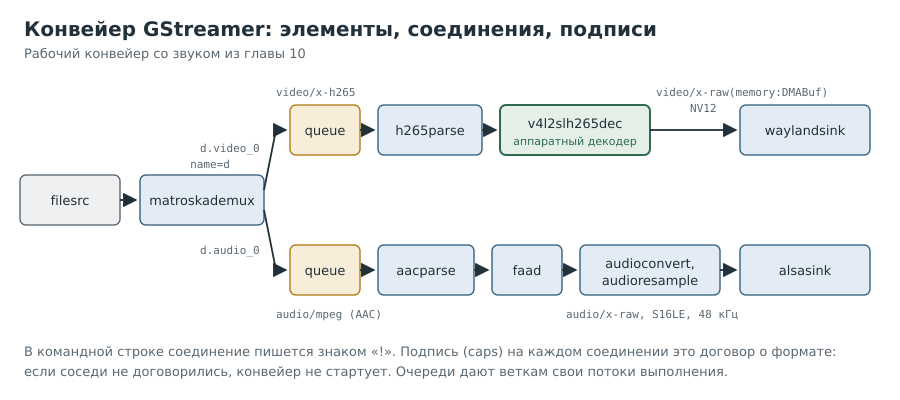

# Глава 6. Первый конвейер и первые замеры

Ядро видит декодер. Теперь нужна программа, которая через него что-нибудь декодирует, и
способ измерить, насколько хорошо. Мы используем GStreamer: для нашего декодера «без
состояния» он работает из пакетов Debian, без самосборок.

---

## Рецепт 6.1. Понять, как устроен GStreamer

**Задача.** Получить мысленную модель, без которой команды GStreamer читаются как шифр.

**Решение.**



**Как это работает.**

- **Элемент** это кубик с одной задачей: читать файл (`filesrc`), разбирать контейнер
  (`matroskademux`), разбирать поток (`h265parse`), декодировать (`v4l2slh265dec`),
  показывать (`waylandsink`) или выбрасывать (`fakesink`).
- **Площадки** (pads) это входы (sink) и выходы (src) элементов. Данные текут от src к sink.
- **Подписи** (caps) это договор о формате на каждом соединении: `video/x-h265`,
  `video/x-raw, format=NV12` и т. д. Соседние элементы обязаны договориться, иначе
  конвейер не стартует.
- **Конвейер** собирается в командной строке через `!`:
  `gst-launch-1.0 filesrc location=a.mkv ! parsebin ! v4l2slh265dec ! fakesink`.

Установка того, что понадобится:

```
[плата]
sudo apt install gstreamer1.0-tools gstreamer1.0-plugins-base gstreamer1.0-plugins-good gstreamer1.0-plugins-bad
```

---

## Рецепт 6.2. Проверить, нашёл ли GStreamer декодер

**Задача.** Убедиться, что для нашего видеоустройства есть элемент.

**Решение.**

```
[плата]
gst-inspect-1.0 v4l2slh265dec
```

**Как это работает.** Плагин `v4l2codecs` при запуске опрашивает устройства без состояния и
создаёт элементы под то, что нашёл. В ответе нас интересуют:

```
Rank        primary + 1 (257)
Klass       Codec/Decoder/Video/Hardware
Version     1.26.2
SINK template: video/x-h265
media-device: /dev/media0   video-device: /dev/video0
```

Высокий ранг (`primary + 1`) значит, что автоматические сборщики конвейеров выберут его
раньше программного декодера.

---

## Рецепт 6.3. Первый конвейер без экрана

**Задача.** Узнать, декодирует ли декодер на самом деле и с какой скоростью.

**Решение.**

```
[плата]
time timeout 30 stdbuf -oL gst-launch-1.0 -v filesrc location=$HOME/test/film.mkv ! parsebin \
  ! v4l2slh265dec ! fpsdisplaysink text-overlay=false video-sink=fakesink sync=false \
  > $HOME/test/run1.log 2>&1
grep -E 'last-message|ERROR|WARN' $HOME/test/run1.log | tail -n 8
```

Ответ стенда:

```
last-message = rendered: 11648, dropped: 0, current: 371.67, average: 393.76
real 0m30.025s   user 0m13.009s   sys 0m5.229s
```

**Как это работает.**
- `fakesink` выбрасывает кадры, `sync=false` отключает привязку к часам. Значит, мы видим
  **предел** декодера, а не 60 кадров/с по таймеру.
- `fpsdisplaysink` считает кадры; с ключом `-v` он раз в секунду печатает `last-message`.
- `timeout 30` останавливает тест, `time` считает затраты процессора.
- `stdbuf -oL` заставляет программу сбрасывать вывод после каждой строки.

**Подводные камни.** Первая попытка у нас вернула пустой вывод: без `stdbuf` вывод копится в
буфере (когда он идёт в канал или файл), а `timeout` убивает процесс сигналом, и буфер
пропадает. Ошибки при этом пишутся небуферизованно, поэтому «нет ошибок» ещё не значит
«всё хорошо».

---

## Рецепт 6.4. Посчитать нагрузку на процессор

**Задача.** Понять, сколько процессора стоит декодирование.

**Решение.** Из вывода `time`:

```
нагрузка (в долях одного ядра) = (user + sys) / real
```

Для рецепта 6.3: (13,0 + 5,2) / 30 ≈ 0,61, то есть 61% одного ядра (около 15% всех
четырёх). На кадр: 18,2 с / 11 648 кадров ≈ 1,6 мс.

**Как это работает.** `user` и `sys` это процессорное время всех потоков процесса, `real`
это время по часам. Отношение и есть средняя загрузка. Оценка для реального просмотра
(60 кадров/с вместо 394) получается делением, но это грубая экстраполяция, а не замер.

**Подводные камни.** Если `user + sys` близко к нулю, а кадров нет, процесс не считает,
а **висит**. Это другой диагноз (см. главы 7 и 10).

---

## Рецепт 6.5. Прочитать, о каком формате договорились элементы

**Задача.** Узнать, в каком формате декодер отдавал кадры.

**Решение.**

```
[плата]
grep -m 3 'video/x-raw' $HOME/test/run1.log | cut -c1-400
```

**Как это работает.** Строки `caps = ...` из лога `-v` показывают договор на каждой
площадке. Например, `format=(string)NV12_32L32` это плиточный формат Allwinner, а
`video/x-raw(memory:DMABuf), format=(string)DMA_DRM, drm-format=(string)NV12` означает,
что кадры идут **буферами декодера** (DMABuf) без копирования в обычную память.

**Подводные камни.** `cut -c1-400` удобен для чтения, но легко отрежет самое важное. Если
строка кажется «оборванной», выведите её целиком.

---

## Рецепт 6.6. Включить подробный журнал одного плагина

**Задача.** Узнать, что делает конкретный элемент внутри.

**Решение.**

```
[плата]
GST_DEBUG='v4l2codecs*:5' gst-launch-1.0 ... > $HOME/test/dbg.log 2>&1
grep -iE 'error|warn|fail|copy|crop|negotiat' $HOME/test/dbg.log | head -n 20
```

**Как это работает.** `GST_DEBUG` задаёт уровни журналов по категориям: `2` это
предупреждения, `5` это отладка. Звёздочка захватывает все категории плагина
(`v4l2codecs-h265dec`, `v4l2codecs-decoder` и т. д.). Именно так мы нашли строки
`Peer supported formats`, `GstVideoMeta support required, copying frames` и
`VIDIOC_S_EXT_CTRLS failed: Invalid argument`, которые многое объяснили в следующих главах.

---

## Что мы намерили

| Файл | Предел декодера, кадров/с |
|---|---|
| H.265 8 бит, 1440x1080@60 | 394 |
| H.265 8 бит, 1920x1080 | 375 |
| H.265 10 бит (Main 10), 1920x1080 | 292 |

Декодер справляется с огромным запасом. Сложности начинаются, когда кадры нужно показать.

---

## Вопросы для самопроверки

1. Зачем в замере предела декодера `sync=false`?
2. Почему без `stdbuf -oL` пропал вывод `fpsdisplaysink`?
3. `real 30 s`, `user 3 s`, `sys 1 s`, кадров 0. Что происходит?
4. Как по подписям caps понять, что кадры не копируются в обычную память?

## Где почитать

- [GStreamer: v4l2slh265dec](https://gstreamer.freedesktop.org/documentation/v4l2codecs/v4l2slh265dec.html)
- [GStreamer: плагин v4l2codecs](https://gstreamer.freedesktop.org/documentation/v4l2codecs/index.html)
- [GStreamer: отладка и переменные окружения](https://gstreamer.freedesktop.org/documentation/tutorials/basic/debugging-tools.html)

---

Назад: [Глава 5. /dev и драйверы](05-dev-and-drivers.md) | Далее: [Глава 7. Как кадр попадает на экран](07-display.md)
