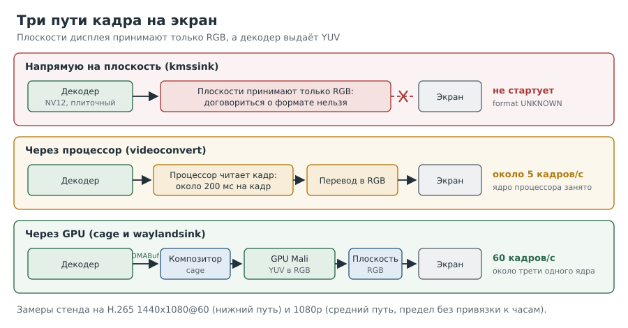

# Глава 7. Как кадр попадает на экран

Декодер выдаёт почти четыреста кадров в секунду. Кажется, осталось «просто показать».
На деле именно здесь проект едва не закончился: за несколько часов мы получили серый
квадрат, 5 кадров в секунду и один чёрный экран. Эта глава объясняет, почему так бывает и
как найти рабочий путь.



---

## Рецепт 7.1. Посмотреть, что умеет дисплейный контроллер

**Задача.** Узнать, какие форматы кадров дисплей принимает напрямую.

**Решение.**

```
[плата]
sudo apt install libdrm-tests
modetest -M sun4i-drm -p > $HOME/test/planes.txt 2>&1
grep -E '^[0-9]+[[:space:]]+[0-9]+[[:space:]]+[0-9]+[[:space:]]+[0-9]+,[0-9]+|formats:' $HOME/test/planes.txt
grep -A4 ' type:' $HOME/test/planes.txt | grep -E 'type:|value'
grep -H . /sys/class/drm/*/status
```

Ответ стенда, сокращённо:

```
33  0   0   ...  formats: AB15 AB30 ... AR24 ... XR24   (Overlay)
39  47  52  ...  formats: AB15 ... AR24 ... XR24        (Primary, на нём консоль)
43  0   0   ...  formats: AB15 ... AR24 ... XR24        (Overlay)
/sys/class/drm/card0-HDMI-A-1/status:connected
```

**Как это работает.** Дисплейный контроллер (DRM/KMS) состоит из:

- **CRTC** формирует сигнал заданного режима (у нас 1920x1080@60);
- **плоскости** (planes) это слои, которые CRTC накладывает друг на друга: основная
  (Primary), оверлеи (Overlay), курсор;
- **коннекторы** это физические выходы (HDMI).

У каждой плоскости свой список форматов. У нас **все три плоскости принимают только RGB**
и только линейные. Ни `NV12`, ни плиточного формата Allwinner, ни AFBC. Значит, кадр из
декодера нельзя «положить» на плоскость напрямую: его сначала нужно перевести в RGB.

**Подводные камни.** Тип плоскости в `modetest` выводится числом: 0 это Overlay, 1 это
Primary, 2 это Cursor.

---

## Рецепт 7.2. Показать картинку напрямую и понять порядок слоёв

**Задача.** Проверить, что сам вывод на экран работает, и выбрать правильную плоскость.

**Решение.**

```
[плата]
sudo timeout 10 gst-launch-1.0 videotestsrc pattern=smpte ! \
  video/x-raw,format=BGRx,width=1920,height=1080 ! kmssink plane-id=43
```

**Как это работает.** `kmssink` выводит кадры прямо на плоскость DRM, без оконной системы.
Без `plane-id` он выбрал плоскость 33, и мы увидели лишь моргание экрана: эта плоскость
лежит **под** основной, а на основной висит консоль. С `plane-id=43` таблица появилась.
`BGRx` в GStreamer соответствует `XR24` в DRM.

**Подводные камни.** Порядок слоёв зависит от драйвера; мы определили его опытом, а не по
документации.

---

## Рецепт 7.3. Узнать цену перевода кадра процессором

**Задача.** Проверить, можно ли переводить NV12 в RGB процессором.

**Решение.** Замерить конвейер с `videoconvert` без экрана:

```
[плата]
time timeout 20 stdbuf -oL gst-launch-1.0 -v filesrc location=$HOME/test/film.mkv ! parsebin \
  ! v4l2slh265dec ! video/x-raw,format=NV12 ! videoconvert n-threads=4 ! video/x-raw,format=BGRx \
  ! fpsdisplaysink text-overlay=false video-sink=fakesink sync=false > $HOME/test/run7.log 2>&1
```

Стенд: **около 5 кадров/с**, процессор занят на ~100% одного ядра. Тот же декодер без
касаний процессором давал 394.

**Как это работает.** Разница в 80 раз не от сложности преобразования (оно добавляло
порядка 10–30 мс на кадр). На кадр уходило около 200 мс, то есть порядка 10 МБ/с. Что-то
делало обращения процессора к кадрам из декодера крайне дорогими. Наша гипотеза: память
буферов декодера отображается без кэша. Её мы не проверяли, но вывод от этого не зависит:
**кадры декодера нельзя трогать процессором.**

**Подводные камни.** В этом же замере сработал ещё и дефект GStreamer, который копировал
кадры (глава 8). Он смешался с основной причиной, и мы далеко не сразу их разделили.

---

## Рецепт 7.4. Отдать кадр композитору без копирования

**Задача.** Вывести кадр через GPU, не трогая его процессором.

**Решение.** Запустить минимальный Wayland-композитор `cage` и отдать ему кадры через
`waylandsink`. `cage` работает только на настоящей консоли, поэтому команды заворачиваем
в скрипт и запускаем **с клавиатуры платы**:

```
[плата]
sudo apt install cage
printf '%s\n' '#!/bin/bash' \
  'cage -- timeout 15 gst-launch-1.0 -v videotestsrc pattern=smpte ! video/x-raw,width=1280,height=720 ! waylandsink > "$HOME/test/cage1.log" 2>&1' \
  > $HOME/cage1.sh && chmod +x $HOME/cage1.sh
```

```
[консоль платы]
./cage1.sh
```

**Как это работает.** Композитор `cage` получает от `waylandsink` буфер DMABuf, просит GPU
(Mali через Panfrost) импортировать его как текстуру и сам переводит YUV в RGB при
отрисовке. Кадр ни разу не проходит через процессор. Этим путём настоящий фильм
1440x1080@60 пошёл с 60,0 кадра/с, без потерь, при загрузке около трети одного ядра
(вместе с самим композитором).

**Подводные камни.**
- `cage` не стартует по SSH: ему нужен доступ к экрану через сеанс на консоли. Если вы
  всё-таки запустили его по SSH и он завис, `pkill -9 -f 'cage --'`: обычный `pkill` с ним
  не справился.
- Опции `cage` проверяйте по `cage -h` своей версии: у версии из Debian 13 нет `-D`.
- Сообщения `eglQueryDeviceStringEXT ... EGL_BAD_PARAMETER` при старте `cage` встречаются
  и в удачных запусках.

---

## Рецепт 7.5. Убедиться, что кадры действительно не копируются

**Задача.** Отличить «настоящий» путь без копий от скрытого копирования.

**Решение.** Сравнить три признака:

1. В подписях caps на входе приёмника есть `video/x-raw(memory:DMABuf)`.
2. В журнале плагина (рецепт 6.6) нет строки `copying frames`.
3. Размер буфера в ошибках или отладке совпадает с размером **внутреннего** буфера
   декодера, а не с размером видимого кадра.

**Как это работает.** Наш поток 1440x1080 декодер хранит как 1440x1088 (высота
выравнивается). Его буфер NV12 занимает 1440×1088×1,5 = 2 350 080 байт. Когда
`waylandsink` упал с ошибкой `cannot have a wl_buffer`, в сообщении стоял буфер
**2 332 800** байт = 1440×1080×1,5: уже обрезанная **копия**. Подписи при этом
по-прежнему обещали DMABuf. Арифметика выдала копирование раньше любого журнала.

---

## Вопросы для самопроверки

1. Почему кадр NV12 нельзя положить на плоскость нашего дисплея напрямую?
2. Что такое плоскость и почему тестовая картинка на плоскости 33 была не видна?
3. Почему конвейер с `videoconvert` давал 5 кадров/с, хотя декодер выдаёт почти 400?
4. Кто переводит YUV в RGB в рабочем пути через `cage`?
5. Как по размеру буфера в ошибке понять, что кадр был скопирован?

## Где почитать

- [Ядро: KMS и плоскости](https://docs.kernel.org/gpu/drm-kms.html)
- [cage: киоск-композитор Wayland](https://github.com/cage-kiosk/cage)
- [GStreamer: kmssink](https://gstreamer.freedesktop.org/documentation/kms/index.html)
- [GStreamer: waylandsink](https://gstreamer.freedesktop.org/documentation/waylandsink/index.html)

---

Назад: [Глава 6. Первый конвейер](06-first-pipeline.md) | Далее: [Глава 8. Когда виновата версия](08-fixing-gstreamer.md)
