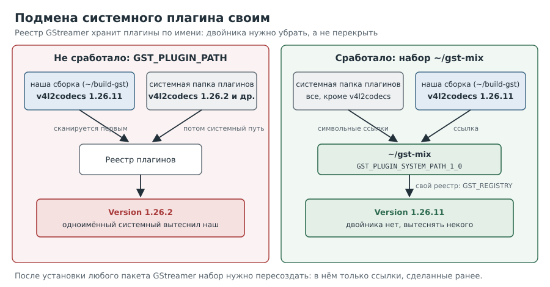

# Глава 8. Когда виновата версия программы

Самые неприятные ошибки те, что выглядят как ограничения железа. Здесь мы увидим, как
дефект одной версии плагина притворялся «медленной платой», как его опознать по
признакам, найти исправление и подключить его, не ломая систему.

---

## Рецепт 8.1. Опознать дефект по признакам

**Задача.** Понять, что проблема не в железе, а в конкретной версии программы.

**Решение.** Сопоставить признаки:

| Признак | Где увидели |
|---|---|
| `GstVideoMeta support required, copying frames` | журнал `v4l2codecs` (рецепт 6.6) |
| `cannot have a wl_buffer` у `waylandsink` | при выводе через `cage` |
| Буфер 1440×1080×1,5 вместо 1440×1088×1,5 | арифметика (рецепт 7.5) |
| Синтетический поток 1280x720 (высота кратна 16) работает, настоящий 1080 нет | опыт |

Последний признак решающий: падает только там, где декодер обрезает 1088 строк до 1080.

**Как это работает.** В GStreamer 1.26.2 (это версия Debian 13) плагин `v4l2codecs`
считал **любую** обрезку поводом копировать кадр в обычную память. Нижняя обрезка
1088→1080 есть почти у каждого 1080p-видео. Копия кадра уже не буфер декодера, Wayland
не может принять её как DMABuf, а процессор тратит на копию сотни миллисекунд. Такой же
случай описан для Raspberry Pi; там же указано, что исправление вошло в выпуск 1.26.11.

**Подводные камни.** Мы дважды выдвигали другие объяснения («медленное преобразование»,
«плата не умеет»). Каждое опровергалось только следующим замером. Держите гипотезы
гипотезами, пока их не подтвердит опыт.

---

## Рецепт 8.2. Найти исправление и убедиться, что оно в исходниках

**Задача.** Не поверить на слово, что «в такой-то версии исправлено».

**Решение.** Скачать исходники и найти признак правки в коде:

```
[плата]
mkdir -p ~/build-gst && cd ~/build-gst
curl -fLO https://gstreamer.freedesktop.org/src/gst-plugins-bad/gst-plugins-bad-1.26.11.tar.xz
tar xf gst-plugins-bad-1.26.11.tar.xz
grep -n 'need_crop\|has_videometa\|copy_frames' \
  gst-plugins-bad-1.26.11/sys/v4l2codecs/gstv4l2codech265dec.c
```

**Как это работает.** В исправленной версии решение о копировании принимается в функции
выбора аллокатора по ответу приёмника (`has_videometa`), а обрезка требуется только при
ненулевом смещении сверху или слева:

```
988:    self->need_crop |= self->crop_rect_x != 0;
989:    self->need_crop |= self->crop_rect_y != 0;
```

Сравнения высоты (из-за которого и копировалось) больше нет.

**Подводные камни.** Выпуск 1.26.11 из той же стабильной ветки, что и 1.26.2, поэтому
собранный плагин работает с системными библиотеками ядра GStreamer. Плагин из ветки 1.28
с ядром 1.26 работать не обязан.

---

## Рецепт 8.3. Собрать один плагин, не трогая систему

**Задача.** Получить исправленный `v4l2codecs`, ничего не устанавливая в `/usr`.

**Решение.**

```
[плата]
sudo apt install build-essential meson ninja-build pkgconf libgstreamer1.0-dev \
  libgstreamer-plugins-base1.0-dev libgudev-1.0-dev libdrm-dev
tmux new -s build
cd ~/build-gst/gst-plugins-bad-1.26.11
meson setup build -Dauto_features=disabled -Dv4l2codecs=enabled --buildtype=release \
  --wrap-mode=nofallback 2>&1 | tee ~/build-gst/meson.log | tail -n 25
time ninja -C build -j2 2>&1 | tee ~/build-gst/ninja.log | tail -n 15
ldd build/sys/v4l2codecs/libgstv4l2codecs.so | grep -E 'codecs|not found'
```

**Как это работает.**
- `-Dauto_features=disabled` выключает все необязательные части, `-Dv4l2codecs=enabled`
  включает нужный плагин.
- `--wrap-mode=nofallback` запрещает meson скачивать недостающие зависимости из интернета:
  если чего-то нет, он остановится с понятным сообщением.
- `-j2`, потому что у платы 1 ГБ памяти. На стенде сборка заняла 6 минут 15 секунд.
- `ldd` показывает, что плагин берёт `libgstcodecs` и `libgstcodecparsers` из **нашей**
  папки сборки (путь вшит при сборке), а остальное из системы.

**Подводные камни.** Мы не запускали `ninja install`. Всё живёт в `~/build-gst`, поэтому
эту папку нельзя удалять, пока плагин в работе.

---

## Рецепт 8.4. Подменить системный плагин своим

**Задача.** Заставить GStreamer использовать наш плагин вместо системного.

**Решение.** Набор плагинов, где системный `v4l2codecs` заменён нашим:



```
[плата]
printf '%s\n' '#!/bin/bash' \
  'rm -rf "$HOME/gst-mix"; mkdir -p "$HOME/gst-mix"' \
  'for f in /usr/lib/aarch64-linux-gnu/gstreamer-1.0/*.so; do' \
  '  [ "$(basename "$f")" = libgstv4l2codecs.so ] || ln -s "$f" "$HOME/gst-mix/"' \
  'done' \
  'ln -s "$HOME/build-gst/gst-plugins-bad-1.26.11/build/sys/v4l2codecs/libgstv4l2codecs.so" "$HOME/gst-mix/"' \
  'ls "$HOME/gst-mix" | wc -l' > $HOME/make-gst-mix.sh && chmod +x $HOME/make-gst-mix.sh
$HOME/make-gst-mix.sh
rm -f $HOME/test/gst-registry-mix.bin
GST_REGISTRY=$HOME/test/gst-registry-mix.bin GST_PLUGIN_SYSTEM_PATH_1_0=$HOME/gst-mix \
  gst-inspect-1.0 v4l2slh265dec | grep -E 'Version|Filename'
```

Нужный ответ:

```
Filename   /home/coop/gst-mix/libgstv4l2codecs.so
Version    1.26.11
```

**Как это работает.**
- Очевидный путь, `GST_PLUGIN_PATH`, на стенде **не сработал**: системный плагин с тем же
  именем вытеснял наш (реестр GStreamer хранит плагины по имени и при совпадении заменяет
  ранее добавленный). Проверка показывала `Version 1.26.2`.
- `GST_PLUGIN_SYSTEM_PATH_1_0` указывает GStreamer **единственное** место поиска
  системных плагинов. Мы кладём туда ссылки на все системные плагины, кроме
  `v4l2codecs`, и наш файл. Двойников нет, вытеснять некого.
- `GST_REGISTRY` задаёт отдельный файл кэша реестра, чтобы обычный кэш не смешивался с
  нашим.

**Подводные камни.**
- Перед выводами про подмену проверьте `Version` и `Filename`. Мы один раз приняли
  неудачную проверку за ошибку переменной, хотя причина была в вытеснении.
- **После установки любого пакета GStreamer пересоздайте набор.** Папка содержит ссылки
  только на плагины, существовавшие в момент создания. Так мы «потеряли» `alsasink`,
  поставленный позже.
- Обновление пакетов GStreamer может разойтись с нашим плагином. Версии стоит закрепить.

---

## Рецепт 8.5. Проверить, что исправление сработало

**Задача.** Подтвердить результат на настоящем файле.

**Решение.** Запустить вывод через композитор (рецепт 7.4) с переменными из рецепта 8.4.
Скрипт целиком есть в [приложении](12-appendix.md#скрипты).

Ответ стенда на файле 1440x1080@60:

```
last-message = rendered: 2358, dropped: 0, current: 59.69, average: 60.04
real 0m41.138s   user 0m6.304s   sys 0m6.759s
```

60 кадров/с, ноль потерь, около трети одного ядра.

---

## Вопросы для самопроверки

1. Какой из признаков в таблице рецепта 8.1 прямо указывал на обрезку?
2. Почему проверку исправления делают по исходному коду, а не по описанию выпуска?
3. Зачем `--wrap-mode=nofallback` при сборке?
4. Почему не сработал `GST_PLUGIN_PATH`, и чем лучше набор в `GST_PLUGIN_SYSTEM_PATH_1_0`?
5. Что произойдёт, если поставить новый пакет GStreamer и не пересоздать набор?

## Где почитать

- [Raspberry Pi: issue #406 о дефекте обрезки в 1.26.2](https://github.com/RPi-Distro/repo/issues/406)
- [GStreamer 1.26: заметки о выпусках](https://gstreamer.freedesktop.org/releases/1.26/)
- [GStreamer: переменные окружения (раздел Running)](https://gstreamer.freedesktop.org/documentation/gstreamer/running.html)
- [Исходники gst-plugins-bad](https://gstreamer.freedesktop.org/src/gst-plugins-bad/)

---

Назад: [Глава 7. Как кадр попадает на экран](07-display.md) | Далее: [Глава 9. Память CMA](09-cma.md)
