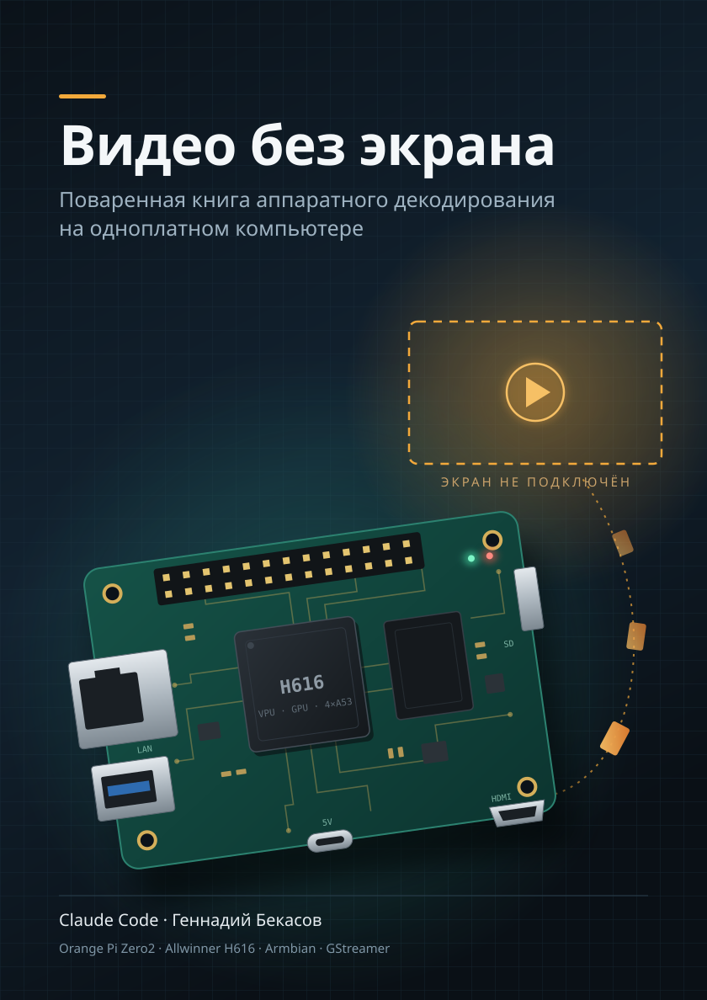

<p align="center"></p>

# Видео без экрана

Поваренная книга аппаратного декодирования видео на одноплатном компьютере: на примере
Orange Pi Zero2 (Allwinner H616), Armbian и GStreamer. От «что лежит внутри MKV» до
H.265 1080p@60 со звуком через аппаратный декодер при загрузке процессора около трети
одного ядра. Второй стенд, Banana Pi M1 (Allwinner A20, H.264), показывает прямой вывод
кадров декодера на плоскость дисплея без композитора и собственный патч для GStreamer.

Авторы: Claude Code и Геннадий Бекасов.

**Скачать PDF:** [последний релиз](https://github.com/bekasov/headless-player-cookbook/releases/latest).

**Начать чтение:** [Предисловие](book/00-preface.md).

## Как читать

- **На GitHub.** Откройте [предисловие](book/00-preface.md) и идите по ссылкам «Далее» внизу
  каждой главы.
- **В Obsidian.** Откройте папку репозитория как хранилище (*Open folder as vault*). Главы
  связаны обычными Markdown-ссылками, у каждой есть псевдоним (`[[Глава 5]]`, `[[Словарь]]`)
  и тег `#книга/глава` или `#книга/приложение`. «Подводные камни» оформлены как callout.
- **В PDF.** Возьмите готовый файл из [релизов](https://github.com/bekasov/headless-player-cookbook/releases)
  или соберите сами командой из раздела [«Сборка PDF»](#сборка-pdf).

## Структура

```text
book/                 текст книги, по файлу на главу, в порядке чтения
  00-preface.md       предисловие, стенд, оглавление
  01…11-*.md          главы
  12…15-appendix-*.md приложения: А скрипты, Б словарь, В ссылки, Г ответы
  img/                схемы (SVG)
scripts/              скрипты из приложения А, готовые к копированию на плату
  a20/                скрипты и патч второго стенда (Banana Pi M1)
tools/
  check.py            проверка ссылок, картинок, блоков кода и скриптов
  build_pdf.py        сборка PDF
  pdf/                стили и метаданные печатной версии
dist/                 результат сборки (не хранится в git)
.github/workflows/    релиз PDF при каждом пуше в main
```

## Правила оформления

- Один файл на главу, имя `NN-тема.md`; порядок задаётся номером.
- В начале файла YAML-frontmatter с `aliases` и `tags` для Obsidian.
- Первая строка блока команд это комментарий с местом выполнения: `# [сервер]` (fish),
  `# [плата]` или `# [консоль платы]` (bash). У каждого блока кода указан язык, у вывода
  программ это `text`.
- «Подводные камни» оформляются как callout:

  ```markdown
  > [!warning] Подводные камни
  > Текст.
  ```

- Ссылки между главами обычные Markdown-ссылки на файл (`[Глава 9](09-cma.md)`), без
  якорей: так они работают одинаково в Obsidian, на GitHub и в PDF.
- Скрипты из приложения А лежат ещё и в `scripts/`. Если меняете один, меняйте и другой:
  `check.py` сверит их.

## Проверка

```bash
python3 tools/check.py             # ссылки, картинки, блоки кода, скрипты
python3 tools/check.py --external  # плюс доступность внешних ссылок
```

## Сборка PDF

Нужны `pandoc` 3+ и Chromium или Chrome 131+.

```bash
python3 tools/build_pdf.py          # dist/headless-player-cookbook.pdf
python3 tools/build_pdf.py --html   # только HTML
```

Сборка склеивает главы, превращает callout в оформленные врезки, ссылки между файлами в
переходы внутри документа, добавляет обложку (`book/img/cover.svg`), содержание и номера
страниц.

## Релизы

Каждый пуш в `main` запускает [`release.yml`](.github/workflows/release.yml): проверка книги,
сборка и релиз с PDF и HTML. Версия это дата коммита в формате `2026-11-04`. Если за этот
день релиз уже есть, он пересоздаётся на новом коммите.

## Лицензия

- Текст книги и схемы (`book/`): [CC BY-SA 4.0](LICENSE-CC-BY-SA-4.0.txt).
- Скрипты и инструменты (`scripts/`, `tools/`, `.github/`): [GPL-3.0](LICENSE).
