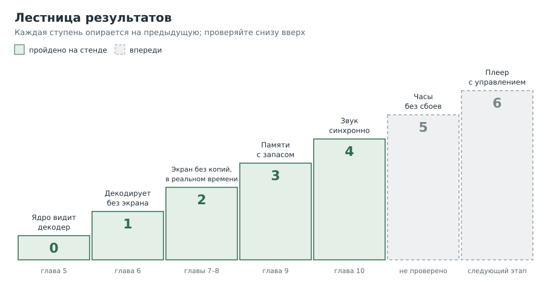

---
aliases:
  - Видео без экрана
  - Предисловие
tags:
  - книга
---

# Видео без экрана

### Поваренная книга аппаратного декодирования на одноплатном компьютере

*На примере Orange Pi Zero2 (Allwinner H616), Armbian и GStreamer*

Авторы: Claude Code и Геннадий Бекасов

---

## Предисловие

Эта книга выросла из одной длинной ночной отладки. Задача звучала скромно: заставить
маленькую плату за двадцать долларов проигрывать фильмы в H.265 без нагрузки на процессор.
Плата это умеет «по паспорту». На деле путь от «по паспорту» до «картинка идёт,
звук синхронный» занял несколько десятков шагов, три неверные гипотезы, одну пересборку
части GStreamer и одну правку параметров ядра.

Каждый из этих шагов оказался отдельным маленьким знанием: как посмотреть, что лежит в
видеофайле; как понять, видит ли ядро аппаратный декодер; почему кадр не может «просто
попасть на экран»; что такое непрерывная память и почему её вечно не хватает; почему
звук способен остановить видео. Здесь эти знания разложены по рецептам, от простого к
сложному.

## Для кого эта книга

Вы уверенно пользуетесь Linux: умеете ходить по SSH, ставить пакеты, читать вывод команд,
пользуетесь `grep` и конвейерами. Но слова «`/dev/video0`», «драйвер без состояния»,
«плоскость дисплея» или «CMA» пока ничего вам не говорят. Это нормально: дальше каждое
такое слово будет объяснено в тот момент, когда понадобится.

Если вы уже опытный, рецепты пригодятся как шпаргалка, а главы 8–11 как разбор реальных
ловушек, на которых теряется время.

Если же слова «SoC», «GPU» или «композитор» звучат туманно, начните с
[главы 0](00a-hardware.md): в ней без команд объяснено, из каких блоков состоит плата и как
кадр путешествует от файла до экрана. Незнакомые слова ищите в
[словаре](13-appendix-b-glossary.md).

## Как устроен рецепт

Каждый рецепт отвечает на один вопрос и построен одинаково:

- **Задача.** Что нужно узнать или сделать.
- **Решение.** Команды, которые это делают.
- **Как это работает.** Почему команды делают именно это.
- **Подводные камни.** Где легко ошибиться. Этот раздел выделен рамкой.

Под заголовком каждого рецепта стоит его уровень:

| Уровень | Что это значит |
|---|---|
| ★☆☆ начальный | Понять идею или посмотреть на систему. Команды только показывают информацию и ничего не меняют. |
| ★★☆ средний | Меняет систему (запись карты, параметры ядра, установка пакетов) или требует держать в голове несколько понятий сразу. |
| ★★★ продвинутый | Сборка из исходников, правка кода, отладка ядра, разбор замеров. Читается после рецептов, на которые ссылается. |

Уровень говорит о сложности, а не о важности: многие продвинутые рецепты можно пропустить при
первом чтении и вернуться к ним, когда что-то не заработает.

## С чего начать

- **Совсем новичок в железе.** Глава 0, затем рецепты ★☆☆ в главах 1, 2, 5, 6 и 7. Этого
  хватит, чтобы понять, что умеет плата и как это проверить.
- **Нужно, чтобы заработало.** Главы 3, 4, 5, 6, 7, 9 и 10 по порядку; продвинутые рецепты
  по мере надобности.
- **Опытный.** Главы 8, 10 и 11: реальные ловушки и методика. Глава 7 для пути кадра на
  экран.

В конце главы есть вопросы для самопроверки, ответы на них собраны в
[приложении Г](15-appendix-d-answers.md).

## Условные обозначения

Первая строка каждого блока команд это комментарий с меткой: где его выполнять.
Блок можно копировать целиком, комментарий ни во fish, ни в bash ничего не делает.
Блоки команд для сервера помечены языком `fish`, для платы `bash`, а вывод программ
помечен как `text`.

| Метка | Где выполнять |
|---|---|
| `# [сервер]` | Компьютер с Linux, с которого вы работаете (оболочка **fish**) |
| `# [плата]` | Плата по SSH (Armbian, оболочка **bash**) |
| `# [консоль платы]` | Клавиатура и монитор, подключённые к самой плате |

Разница между fish и bash важна в двух местах. Во fish не работает heredoc (`<<EOF`),
поэтому файлы мы создаём через `printf ... | tee`. Знак `?` во fish может восприниматься как
шаблон, поэтому аргументы с ним берём в кавычки.

> [!important] Правило книги
> Всё, что здесь названо фактом, было либо измерено на стенде, либо
> сверено с документацией. Всё остальное явно помечено как гипотеза или общее знание.

## Стенды

| Что | Подробности |
|---|---|
| Плата | Orange Pi Zero2, Allwinner H616, 1 ГБ ОЗУ, карта microSD 16 ГБ |
| ОС платы | Armbian 26.11 (rolling, community), Debian 13 «trixie» |
| Ядро | 6.18.57-current-sunxi64 |
| Видео | HDMI на монитор 1920x1080@60 |
| Сервер | Linux, видеокарта Radeon RX 6700 XT (рецепт 1.3), Jellyfin в Docker |

**Второй стенд.** На нём проверены рецепты 2.9, 4.7–4.8, 5.7, 6.7, 7.6–7.10, 8.6–8.7, 9.5,
10.8–10.9 и 11.7–11.8; в тексте они помечены словами «второй стенд».

| Что | Подробности |
|---|---|
| Плата | Banana Pi BPI-M1, Allwinner A20 (2 ядра Cortex-A7, armhf), 1 ГБ ОЗУ, карта microSD 64 ГБ |
| ОС платы | Armbian 26.8.3, Debian 13 «trixie» |
| Ядро | 6.18.44-current-sunxi |
| Видео и звук | HDMI на монитор 1920x1080@60, звук по HDMI на динамики монитора |
| Кодек | H.264 (H.265 декодер A20 не умеет) |
| Сервер | тот же |

## Что получилось в итоге

Аппаратный декодер H616 проигрывает H.265 8 и 10 бит в 1080p и 1440x1080@60 в реальном
времени, без потерянных кадров, со звуком по HDMI и синхронно. Процессор занят примерно
на треть одного ядра из четырёх. Для этого понадобились три нестандартных шага, каждому
посвящена своя глава: исправленный плагин GStreamer (глава 8), увеличенная непрерывная
память (глава 9) и большие очереди между звуком и видео (глава 10).

На втором стенде (A20) путь оказался другим. Его дисплей принимает кадр декодера как есть,
поэтому композитор не нужен: после правки трёх мест в плагине `v4l2codecs` (глава 8) фильм
1920x800@24 идёт прямо на плоскость дисплея, со звуком AC-3 по HDMI, синхронно, примерно на
четверть одного ядра (почти всё это звук). Потолок декодера A20 около 46 мегапикселей в
секунду, поэтому 1080p@24 он не успевает.

## Лицензия

Текст и схемы книги распространяются по лицензии
[CC BY-SA 4.0](https://creativecommons.org/licenses/by-sa/4.0/deed.ru): их можно копировать,
переделывать и распространять с указанием авторов и под той же лицензией. Скрипты и
инструменты сборки распространяются по лицензии [GPL-3.0](https://www.gnu.org/licenses/gpl-3.0.html).

## Оглавление

0. [Железо: короткое введение для начинающих](00a-hardware.md) — SoC, Allwinner, Mali, композитор; можно пропустить.
1. [Кодеки, контейнеры и потоки](01-codecs.md) — что лежит внутри видеофайла и чем H.265 отличается от H.264.
2. [Смотрим внутрь файла из консоли](02-inspecting-files.md) — `ffprobe`, разбор цветов, порядок пакетов.
3. [Выбор ОС для одноплатника](03-choosing-os.md) — почему нельзя взять «любой ARM-дистрибутив».
4. [Образ, проверка, запись, первый вход](04-first-boot.md) — без сюрпризов и без затёртых дисков.
5. [`/dev`, драйверы и видит ли ядро декодер](05-dev-and-drivers.md) — первая встреча с железом.
6. [Первый конвейер и первые замеры](06-first-pipeline.md) — GStreamer, кадры в секунду и нагрузка.
7. [Как кадр попадает на экран](07-display.md) — плоскости, копирование, композитор и прямой путь.
8. [Когда виновата версия программы](08-fixing-gstreamer.md) — сборка одного плагина, подмена системного и своя правка.
9. [Память для видео: CMA](09-cma.md) — почему декодеру не хватает памяти при 700 МБ свободных.
10. [Звук и синхронность](10-audio-and-sync.md) — как звук может остановить видео.
11. [Методика: как понять, что достигнуто](11-method.md) — метрики, опоздание кадров, дерево решений, грабли.

Приложения:

- [А. Скрипты](12-appendix-a-scripts.md) — всё, что запускалось на стенде, целиком.
- [Б. Словарь](13-appendix-b-glossary.md) — термины книги в одном месте.
- [В. Ссылки](14-appendix-c-links.md) — документация и обсуждения.
- [Г. Ответы на вопросы](15-appendix-d-answers.md) — к вопросам для самопроверки.

## Схемы

| Файл | О чём |
|---|---|
| [00-soc-blocks.svg](img/00-soc-blocks.svg) | Что внутри SoC и путь кадра |
| [01-container.svg](img/01-container.svg) | Контейнер, потоки и кодеки |
| [03-boot-chain.svg](img/03-boot-chain.svg) | Цепочка загрузки ARM-платы |
| [03-os-choice.svg](img/03-os-choice.svg) | Как выбирать ОС |
| [05-video-stack.svg](img/05-video-stack.svg) | Видеостек Linux от железа до программы |
| [05-stateless.svg](img/05-stateless.svg) | Декодеры «с состоянием» и «без» |
| [06-pipeline.svg](img/06-pipeline.svg) | Конвейер GStreamer |
| [07-display-paths.svg](img/07-display-paths.svg) | Три пути кадра на экран |
| [07-tiled-pitch.svg](img/07-tiled-pitch.svg) | Шаг плиточного кадра: что ждёт ядро |
| [07-vsync-waits.svg](img/07-vsync-waits.svg) | Лишние ожидания обновления экрана |
| [08-plugin-mix.svg](img/08-plugin-mix.svg) | Подмена системного плагина |
| [09-cma.svg](img/09-cma.svg) | Непрерывная память до и после |
| [10-preroll.svg](img/10-preroll.svg) | Взаимная блокировка звука и видео |
| [10-decoder-queue.svg](img/10-decoder-queue.svg) | Очередь после декодера |
| [11-levels.svg](img/11-levels.svg) | Лестница результатов |
| [11-no-picture.svg](img/11-no-picture.svg) | Дерево решений «нет картинки» |

---

Далее: [Глава 0. Железо](00a-hardware.md)
