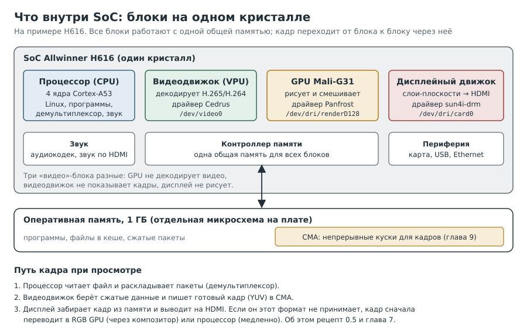
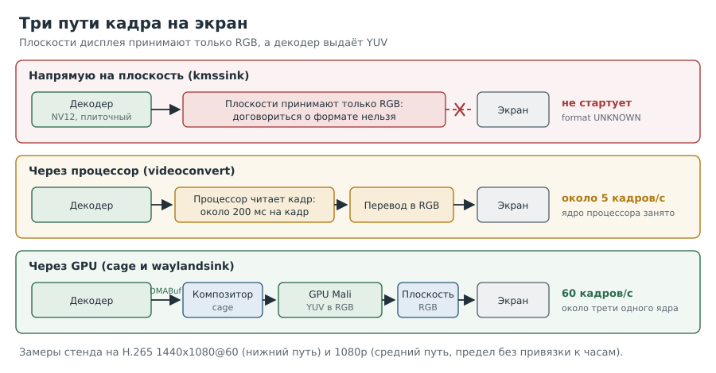

---
aliases:
  - Глава 0
  - Железо
tags:
  - книга/глава
---

# Глава 0. Железо: короткое введение для начинающих

Остальные главы говорят о плате на языке команд: `/dev/video0`, `sun4i-drm`, «плоскость»,
«композитор». За каждым таким словом стоит кусок железа. Эта глава рассказывает, что это за
куски, откуда они взялись и почему на двух похожих платах кадр идёт на экран разными путями.

> [!tip] Уже знаете железо?
> Здесь почти нет команд, только фон. Можно сразу перейти к
> [главе 1](01-codecs.md) и возвращаться сюда по ссылкам из текста.

Факты о чипах в этой главе сверены с описанием железа в исходниках ядра Linux (файлы
`.dtsi`, драйверы) и со статьями, перечисленными в конце. Годы выпуска приведены только
там, где их удалось подтвердить.

---

## Рецепт 0.1. Понять, что такое одноплатный компьютер и SoC

**Уровень:** ★☆☆ начальный

**Задача.** Разобраться, чем «компьютер размером с банковскую карту» устроен иначе, чем ПК.

**Решение.** Запомнить одно слово: **SoC** (System on a Chip, система на кристалле).



**Как это работает.** В ПК процессор, видеокарта, звуковая карта и контроллеры это разные
микросхемы, а то и разные платы. В одноплатнике почти всё это собрано на одном кристалле:

- **процессор** (CPU): несколько ядер ARM, на них работают Linux и программы;
- **GPU**: графический процессор, рисует картинку и умеет быстро смешивать изображения;
- **видеодвижок** (VPU, Video Engine): отдельный блок, который только декодирует сжатое
  видео и делает это без участия процессора;
- **дисплейный движок** (Display Engine): берёт готовые кадры из памяти и выводит их на
  HDMI;
- звук, контроллеры карты памяти, USB, Ethernet.

Рядом с SoC на плате стоит микросхема оперативной памяти, общей для всех блоков. Видеокарта
ПК держит кадры в своей памяти; здесь видеодвижок, GPU и дисплей передают кадры друг другу
через общую память. Отсюда в книге целая глава о памяти для видео (глава 9).

Какой SoC стоит на плате, ядро знает из описания платы (devicetree, рецепт 3.1):

```bash
# [плата]
tr '\0' '\n' < /proc/device-tree/compatible
nproc
```

По исходникам ядра для Orange Pi Zero2 это строки `xunlong,orangepi-zero2` и
`allwinner,sun50i-h616`, для Banana Pi M1 `lemaker,bananapi` и `allwinner,sun7i-a20`.
Сначала идёт плата, потом чип. `nproc` покажет число ядер процессора.

> [!warning] Подводные камни
> «Плата поддерживается в Linux» обычно значит, что работают процессор и базовая
> периферия. У видеодвижка, GPU и дисплея свои драйверы, и каждый может отставать на годы
> (рецепт 3.1).

---

## Рецепт 0.2. Узнать, кто такой Allwinner и как читать названия чипов

**Уровень:** ★☆☆ начальный

**Задача.** Понять, откуда взялись H616 и A20 и почему в командах встречаются странные
имена вроде `sun4i` и `sun50i`.

**Решение.** Allwinner Technology это китайская компания из Чжухая (провинция Гуандун),
основанная в 2007 году. Она проектирует чипы, а производят их на сторонних фабриках. Буква в
названии чипа говорит о назначении:

| Серия | Для чего | Примеры |
|---|---|---|
| A | планшеты и мобильные устройства | A10, A20, A31, A64 |
| H | ТВ-приставки (с 2014 года) | H3, H5, H6, H616 |
| R | маломощные устройства («Real-Time») | R16, R40 |
| V | видео: камеры, регистраторы | V3s |
| F | недорогие медиаустройства | F1C100s |

Чипы, которые встречаются в книге и рядом с ней:

| Чип | Процессор | GPU | Дисплей | Имя в ядре |
|---|---|---|---|---|
| A10 | 1 ядро Cortex-A8 | Mali-400 | DE1 (frontend + backend) | `sun4i` |
| A20 | 2 ядра Cortex-A7 | Mali-400 MP2 | DE1 (frontend + backend) | `sun7i` |
| H3 | 4 ядра Cortex-A7 | Mali-400 | DE2 | `sun8i` |
| H6 | 4 ядра Cortex-A53 | Mali-T720 MP2 | DE3 | `sun50i` |
| H616 | 4 ядра Cortex-A53 | Mali-G31 MP2 | DE3.3 | `sun50i` |

**Как это работает.**

- **A20** анонсирован в декабре 2012 года: двухъядерный, 32-битный (armhf), с видеодвижком для
  H.264, но без H.265. На нём построены Banana Pi M1 и многие платы того времени. Это наш
  второй стенд.
- **H616** это чип для ТВ-приставок: четыре 64-битных ядра (arm64), аппаратный H.265 и
  10-битное видео. На нём Orange Pi Zero2, наш основной стенд.
- **Имена в ядре.** Сообщество, которое переносит поддержку Allwinner в Linux, зовётся
  **linux-sunxi**, а чипы в ядре называются `sunNi`: A10 это `sun4i`, A20 `sun7i`, H3 `sun8i`,
  64-битные H5, H6 и H616 `sun50i`. Драйвер получает имя по первому чипу, для которого его
  написали, и сохраняет его для новых. Поэтому на H616 дисплеем управляет `sun4i-drm`, а звук
  называется `sun4i-codec` (рецепты 7.1 и 10.1), хотя чип на много лет моложе A10.
- **Почему поддержка приходит с опозданием.** Allwinner выпускает к чипам собственное ядро
  (его называют BSP, board support package), обычно старое. Поддержку в основном ядре Linux
  в основном пишут сообщество и компании вроде Bootlin. Драйвер видеодвижка **Cedrus**
  Bootlin переносил в основное ядро в 2018 году; он до сих пор лежит в разделе `staging`
  (драйверы, которые ещё доводят). Отсюда совет главы 3: прежде чем выбирать ОС, смотреть
  состояние драйверов.

> [!warning] Подводные камни
> - Похожие названия не значат похожее железо. H6 и H616 близки, но дисплейные движки у них
>   разных поколений (DE3 и DE3.3), и драйверы для них появлялись в разное время.
> - Назначение серий выше это общая картина по открытым источникам, а не официальная
>   классификация Allwinner.

---

## Рецепт 0.3. Отличить GPU, видеодвижок и дисплей

**Уровень:** ★☆☆ начальный

**Задача.** Перестать путать три блока, которые все «про видео».

**Решение.** Свести их в одну таблицу:

| | Видеодвижок | GPU | Дисплейный движок |
|---|---|---|---|
| Что делает | распаковывает сжатое видео в кадры | рисует, смешивает, переводит цвета | показывает кадры из памяти на экране |
| Чего не умеет | показывать, рисовать | декодировать видео | декодировать, рисовать |
| H616 | Cedrus | Mali-G31, драйвер Panfrost | DE3.3, драйвер `sun4i-drm` |
| A20 | Cedrus | Mali-400, драйвер Lima | DE1, драйвер `sun4i-drm` |
| Файл устройства | `/dev/video0` | `/dev/dri/renderD128` | `/dev/dri/card0` |
| Где в книге | главы 5, 6, 8 | рецепт 7.4 | глава 7 |

Какие драйверы стоят за `/dev/dri`:

```bash
# [плата]
grep -H DRIVER /sys/class/drm/card?/device/uevent
```

На H616 ожидаемо увидеть `sun4i-drm` и `panfrost`, на A20 `sun4i-drm` и `lima`.

**Как это работает.** Кадр при просмотре проходит через все три блока по очереди, но
каждый делает свою часть. Видеодвижок пишет кадр в память. Дисплей читает его оттуда
**сам**, без процессора. GPU нужен только тогда, когда кадр надо переделать перед показом:
перевести цвета, уменьшить, наложить окна друг на друга.

> [!warning] Подводные камни
> Мощный GPU не помогает декодировать видео: декодирует только видеодвижок. Поэтому
> «у платы Mali» ничего не говорит о том, потянет ли она H.265 (рецепт 1.2).

---

## Рецепт 0.4. Понять, что такое Mali и почему у драйвера странное имя

**Уровень:** ★☆☆ начальный

**Задача.** Разобраться, что такое Mali-G31 и Mali-400 и почему к ним разные драйверы.

**Решение.** Mali это не производитель, а серия GPU, которую разрабатывает ARM и продаёт
производителям чипов в виде лицензии. Allwinner покупает готовый блок и ставит на свой
кристалл. Родом Mali из Норвегии: их сделала компания Falanx Microsystems, которую ARM купила
в 2006 году.

| Поколение | Модели | Свободный драйвер |
|---|---|---|
| Utgard | Mali-400, Mali-450 | Lima |
| Midgard | Mali-T720 и другие T | Panfrost |
| Bifrost | Mali-G31, Mali-G52 | Panfrost |
| Valhall | Mali-G57, Mali-G77 | Panfrost, для новых Panthor |

**Как это работает.**

- ARM долго выпускала для Mali только закрытые драйверы. Свободные написали энтузиасты,
  разбирая работу железа: **Lima** для старых Utgard (в основном ядре с 2019 года) и
  **Panfrost** для Midgard и новее. Отсюда и имена: это не продукты ARM.
- **MP2** в названии означает число ядер GPU: Mali-G31 MP2 это два ядра.
- В книге GPU работает в одном месте: композитор `cage` просит его перевести кадр из YUV в
  RGB (рецепт 7.4). Для этого достаточно даже скромного Mali-G31.

> [!warning] Подводные камни
> Поддержка GPU в ядре и в Mesa (библиотеке, которая даёт программам OpenGL) это две половины
> одного драйвера. Нужны обе, а их версии в дистрибутиве могут отставать друг от друга.

---

## Рецепт 0.5. Понять, что такое композитор и почему на A20 он не нужен

**Уровень:** ★☆☆ начальный

**Задача.** Разобраться, зачем на основном стенде понадобился `cage`, а на втором кадры
пошли на экран без него.

**Решение.** Сначала о плоскостях, потом о композиторе.

**Плоскости.** Дисплейный движок не просто «выводит картинку». У него есть несколько
**слоёв** (плоскостей, planes), как у прозрачных плёнок на проекторе: внизу основная, на ней
консоль, поверх оверлеи. Каждый слой берёт свой буфер из памяти, а движок накладывает слои
друг на друга прямо при выводе на HDMI. Важно, **в каком формате** слой принимает буфер:
одни только RGB, другие ещё и YUV, третьи даже плиточный YUV прямо из видеодвижка.

**Композитор.** Когда на экране несколько окон, каждая программа рисует своё окно в свой
буфер. Кто-то должен собрать из них одну картинку: расставить окна, перевести цвета, наложить
курсор. Эта программа и есть **композитор**. В Wayland композитор одновременно и графический
сервер: GNOME (Mutter), KDE (KWin), Weston, sway. `cage` из главы 7 это самый маленький
композитор: он показывает одну программу на весь экран. Свою работу композиторы обычно
поручают GPU.

**Почему на H616 нужен композитор.** Видеодвижок выдаёт кадры в YUV (рецепт 0.6). На
стенде все плоскости H616 принимали только RGB (рецепт 7.1). Значит, кадр перед показом надо
перевести в RGB. Процессором это 5 кадров/с (рецепт 7.3), а GPU делает это быстро, но GPU
нужен кто-то, кто им управляет. Этим «кем-то» и стал композитор: он получает кадр без
копирования (DMABuf), просит Mali перевести цвета и отдаёт результат на плоскость.

**Почему на A20 не нужен.** У A20 дисплейный движок старого поколения, DE1. В нём перед
слоями стоит блок **frontend**, который сам переводит YUV в RGB и масштабирует, причём
принимает и плиточный формат видеодвижка Allwinner (это видно в драйвере
`sun4i_frontend.c`). Плоскость A20 берёт кадр декодера как есть (рецепт 7.6), и GPU с
композитором не нужны вовсе: `kmssink` кладёт кадр прямо на плоскость (рецепт 7.7).

| | H616 (основной стенд) | A20 (второй стенд) |
|---|---|---|
| Что принимают плоскости на стенде | только RGB | RGB, YUV, плитки Allwinner |
| Кто переводит YUV в RGB | GPU через композитор `cage` | сам дисплейный движок |
| Конвейер заканчивается на | `waylandsink` | `kmssink` |
| Процессор на вывод видео | около трети ядра вместе с композитором | меньше 1% ядра |



**Как это работает.** Самый дешёвый путь кадра тот, где его никто не трогает: видеодвижок
пишет, дисплей читает. Такой путь возможен, только если формат кадра из видеодвижка совпадает
с тем, что принимает плоскость. Всё остальное (GPU, композитор, процессор) это способы
подогнать формат, и каждый чего-то стоит.

> [!warning] Подводные камни
> - «Принимает только RGB» мы видели на ядре стенда (6.18.57). Умеет ли железо H616 больше,
>   зависит и от драйвера: в исходниках основного ядра на ноябрь 2026 у смесителя H616 описан
>   один видеослой (VI), а такие слои у этого драйвера принимают NV12. Если на более свежем
>   ядре `modetest` покажет плоскость с `NV12`, прямой путь без композитора может заработать и
>   на H616. Мы это не проверяли (рецепт 11.6).
> - Композитор нужен и для обычного рабочего стола с окнами. Прямой вывод на плоскость
>   подходит, когда экран целиком принадлежит одной программе: плееру, киоску.

---

## Рецепт 0.6. Понять, как кадр лежит в памяти: YUV, NV12 и плитки

**Уровень:** ★★☆ средний

**Задача.** Разобраться в словах `NV12`, `ST12`, «плитки» и «шаг строки», без которых не
читаются главы 5, 7 и 8.

**Решение.** Три идеи по очереди.

**YUV вместо RGB.** Экран светит красным, зелёным и синим (RGB). Видео же хранят как
**яркость** (Y) и две **цветоразности** (U и V). Глаз к цвету менее чувствителен, чем к
яркости, поэтому цветоразности хранят вдвое реже по горизонтали и по вертикали (4:2:0,
рецепт 1.4). Кадр от этого получается в два раза меньше, чем в RGB.

**NV12.** Самая частая раскладка YUV 4:2:0 в памяти: сначала все строки яркости, затем
вдвое меньше строк, где U и V чередуются. Отсюда размер кадра:

```text
ширина × высота × 1,5 байт      (1920 × 1088 × 1,5 = 3 133 440)
```

Эта формула не раз выручит в главах 5 и 7: по размеру буфера видно, чей это буфер и не
скопирован ли он.

**Плитки (tiles).** Видеодвижок Allwinner пишет кадр не построчно, а квадратами 32x32
пикселя. Видеодвижку так удобнее работать с памятью. Такой формат в V4L2 называется `ST12`,
в GStreamer `NV12_32L32`, в DRM это `NV12` с **модификатором** `ALLWINNER_TILED`. Три имени
одного и того же кадра, и путаница между ними стоила нам рецепта 8.6.

**Как это работает.**

- **Шаг строки** (stride, pitch) это сколько байт в памяти от начала одной строки до начала
  следующей. Он бывает больше ширины: строки выравнивают, например до кратного 32.
- **Выравнивание по высоте.** Видео кодируют блоками по 16 строк и больше, поэтому кадр
  1080 строк декодер хранит как 1088, а лишние 8 строк при показе обрезаются (рецепты 5.7,
  7.10 и глава 8).
- Программа, которая читает плиточный кадр процессором, должна знать о плитках. Дисплей,
  который понимает плитки сам (A20), избавляет от этого (рецепт 0.5).

> [!warning] Подводные камни
> `ffprobe` показывает размеры потока, а не буфера: о выравнивании до 1088 он не скажет
> (рецепт 5.7). Размер буфера спрашивайте у драйвера.

---

## Вопросы для самопроверки

1. Чем видеодвижок отличается от GPU? Какой из них декодирует H.265?
2. Почему на H616 дисплеем управляет драйвер с именем `sun4i-drm`?
3. Что делает композитор и почему на A20 без него можно обойтись?
4. Сколько байт занимает кадр 1280x720 в NV12?
5. Почему Mali-400 и Mali-G31 обслуживают разные драйверы?

## Где почитать

- [Allwinner Technology — Wikipedia](https://en.wikipedia.org/wiki/Allwinner_Technology)
- [Mali (GPU) — Wikipedia](https://en.wikipedia.org/wiki/Mali_%28processor%29)
- [Mesa: драйвер Panfrost](https://docs.mesa3d.org/drivers/panfrost.html)
- [Mesa: драйвер Lima](https://docs.mesa3d.org/drivers/lima.html)
- [Wayland: архитектура и роль композитора](https://wayland.freedesktop.org/architecture.html)
- [Bootlin: перенос видеодвижка Allwinner в основное ядро, 2018](https://bootlin.com/blog/allwinner-vpu-support-in-mainline-linux-status-update/)
- [Ядро: исходники драйвера Cedrus](https://github.com/torvalds/linux/tree/master/drivers/staging/media/sunxi/cedrus)

---

Назад: [Предисловие](00-preface.md) | Далее: [Глава 1. Кодеки](01-codecs.md)
