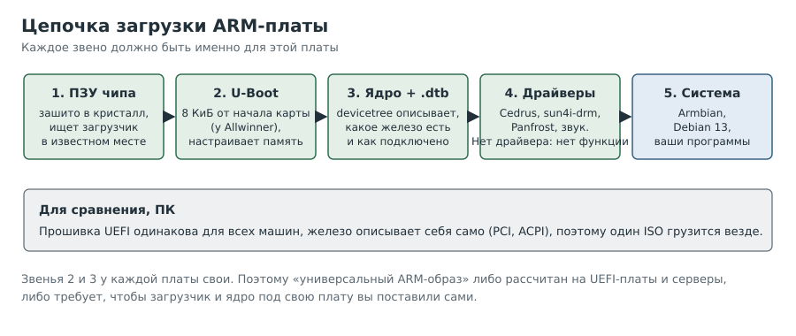
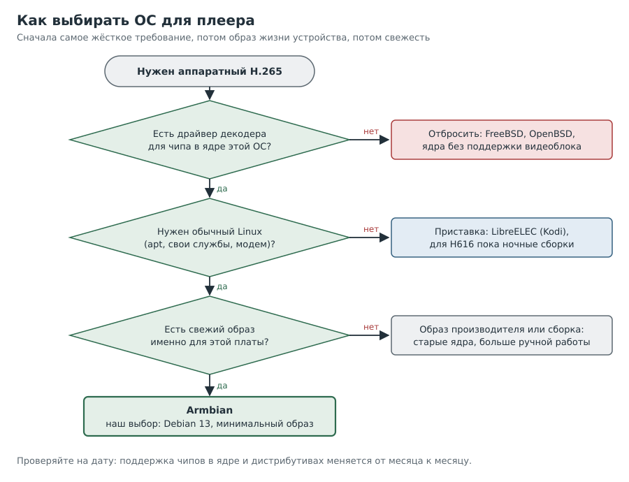

---
aliases:
  - Глава 3
tags:
  - книга/глава
---

# Глава 3. Выбор ОС для одноплатника

На ПК всё просто: скачал образ любой системы, загрузился, поставил. На одноплатнике так
не выйдет, и прежде чем выбирать, полезно понять почему.

---

## Рецепт 3.1. Понять, почему нельзя взять «любой ARM-дистрибутив»

**Задача.** Разобраться, чем загрузка платы отличается от загрузки ПК.

**Решение.** Посмотреть на цепочку загрузки:

**Как это работает.** На ПК прошивка (UEFI) одинакова для всех машин, а оборудование само
себя описывает (шина PCI, таблицы ACPI). Поэтому один ISO грузится везде. На плате:

1. **Загрузчик в ПЗУ чипа** ищет следующий этап в строго определённом месте карты. У
   Allwinner это смещение 8 КиБ от начала. Там должен лежать **U-Boot**, собранный именно
   под эту плату (он, в частности, знает, как настроить её память).
2. **Описание платы** (devicetree, файл `.dtb`) рассказывает ядру, какие блоки есть на
   кристалле и как они подключены. Само железо этого не сообщает.
3. **Драйверы** нужны для каждого блока чипа: тактирование, выводы, карта, Ethernet,
   видео. Всё, чего нет в ядре, просто не работает. На Zero2, например, не работает Wi-Fi.

Образы для ARM бывают трёх видов: готовые под конкретную плату (Armbian,
Raspberry Pi OS); универсальные с UEFI для серверов и виртуальных машин; архивы корневой
системы (Arch Linux ARM), где загрузчик и ядро вы ставите сами.

> [!warning] Подводные камни
> «Плата поддерживается» значит, что система грузится и видит базовое
> железо. Это ничего не говорит о видеодекодере, у которого свой драйвер и своя программная
> цепочка сверху.

---

## Рецепт 3.2. Найти, какие системы вообще есть для платы

**Задача.** Составить список кандидатов на сегодняшний день, а не по памяти.

**Решение.** Пройти по источникам по порядку:

1. Страница платы у производителя: там образы производителя и список «сторонних».
2. Страница платы у Armbian: виды образов, ядро, уровень поддержки, дата сборки.
3. Загрузки LibreELEC: стабильные и ночные сборки.
4. Списки поддерживаемого железа дистрибутивов (DietPi, Debian, NixOS, FreeBSD, OpenBSD).
5. Состояние драйвера декодера в ядре (для Allwinner это Cedrus).

**Как это работает.** Ответ меняется месяц от месяца. Поддержка H616 в Cedrus, например,
долго жила в виде патчей на рассылке ядра и в отдельных сборках, а не в основном ядре.

> [!warning] Подводные камни
> Выдача поисковика полна старых страниц 2021–2023 годов. Всегда
> смотрите на дату.

---

## Рецепт 3.3. Сравнить кандидатов для Orange Pi Zero2 (ноябрь 2026)

**Задача.** Выбрать ОС для плеера с аппаратным H.265.

**Решение.** Сводная таблица того, что мы нашли:

| Система | Что есть для Zero2 | Для плеера |
|---|---|---|
| **Armbian** | Свежие образы Debian 13 и Ubuntu 26.04, ядро 6.18, поддержка «сообщество» | Обычный Debian, ставится что угодно. Декодер Cedrus для H616 в ядре есть (проверено) |
| **LibreELEC** | Стабильная 12.2 без H616; ночные 13.0 с каталогом `orangepi-zero2` | Приставка Kodi без `apt`; путь, на котором H616 активно доводят |
| **Образы производителя** | Debian/Ubuntu/Arch на старых ядрах 4.9/5.4/6.1 | Для родственной Zero2W производитель пишет «Video codec: NO» |
| **DietPi** | Официального образа нет | Надстройка над Debian/Armbian, ядро то же |
| **Debian, NixOS, Arch ARM** | Загружаются на основном ядре, частично вручную | Декодер зависит от патчей в ядре |
| **FreeBSD, OpenBSD** | Базовая поддержка H616 | V4L2 и Cedrus нет, аппаратного видео не будет |

Мы выбрали **Armbian, Debian 13 (trixie), минимальный консольный образ**.

**Как это работает.** Для плеера важны три вещи: есть ли в ядре драйвер декодера, есть ли
путь кадров на экран и можно ли поставить нужные программы. Armbian дал первое и третье
сразу, а второе пришлось доводить (главы 7–8).

> [!warning] Подводные камни
> - В Debian 13 пакетный mpv 0.40 по сообщениям форума Armbian несовместим со сборками ffmpeg
>   с поддержкой v4l2request. Поэтому на Trixie мы пошли через GStreamer, а не через mpv.
> - Образ Arch от производителя с ядром 6.1.31 сам до свежего ядра не обновится: это
>   вендорское ядро, а не ядро Arch.

---

## Рецепт 3.4. Выбирать по схеме, а не по привычке

**Задача.** Принять решение, когда вариантов много.

**Решение.**

**Как это работает.** Отсекаем варианты по самому жёсткому требованию первым (есть ли
декодер в ядре), потом по образу жизни устройства (приставка или обычный Linux), потом по
свежести и поддержке.

---

## Рецепт 3.5. Debian или Ubuntu внутри Armbian

**Задача.** Выбрать между двумя вариантами образа Armbian.

**Решение.** Для плеера разница меньше, чем кажется:

- **snap.** Образы Armbian не содержат snapd, а браузеры из Ubuntu, которые тянут snap, на
  плеере не нужны. Это не повод отказываться от Ubuntu.
- **Версии пакетов.** У Ubuntu они свежее, у Debian стабильнее. Важнее проверить версии
  именно тех программ, на которые вы рассчитываете (mpv, ffmpeg, GStreamer), в обоих.
- **Поддержка.** Debian 13 это текущая стабильная ветка Debian.

---

## Вопросы для самопроверки

1. Почему один и тот же образ ARM не загрузится на двух разных платах?
2. Что значит «плата поддерживается», и что это *не* гарантирует?
3. Почему для нашего плеера не подходит FreeBSD, хотя H616 там поддерживается?
4. Зачем перед выбором ОС проверять состояние драйвера декодера в ядре?

## Где почитать

- [Armbian: Orange Pi Zero2](https://www.armbian.com/boards/orangepizero2)
- [LibreELEC: загрузки Allwinner](https://libreelec.tv/downloads/allwinner/)
- [LibreELEC: ночные сборки 13.0 Allwinner](https://test.libreelec.tv/13.0/Allwinner/)
- [Ядро: исходники драйвера Cedrus](https://github.com/torvalds/linux/tree/master/drivers/staging/media/sunxi/cedrus)
- [Форум Armbian: репозиторий v4l2request](https://forum.armbian.com/topic/32449-repository-for-v4l2request-hardware-video-decoding-rockchip-allwinner/)

---

Назад: [Глава 2. Смотрим внутрь файла](02-inspecting-files.md) | Далее: [Глава 4. Первый вход](04-first-boot.md)
