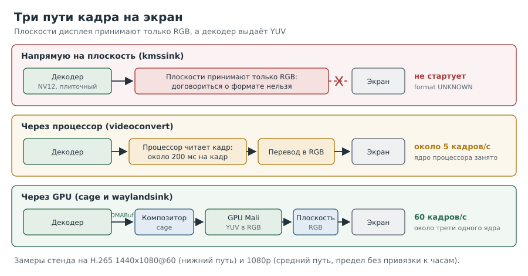
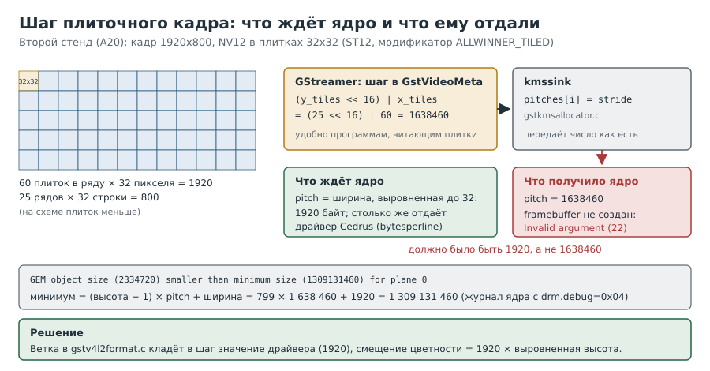
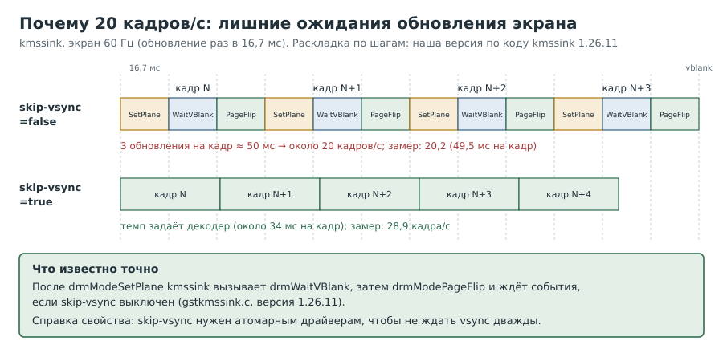

---
aliases:
  - Глава 7
tags:
  - книга/глава
---

# Глава 7. Как кадр попадает на экран

Декодер выдаёт почти четыреста кадров в секунду. Кажется, осталось «просто показать».
На деле именно здесь проект едва не закончился: за несколько часов мы получили серый
квадрат, 5 кадров в секунду и один чёрный экран. Эта глава объясняет, почему так бывает и
как найти рабочий путь.

На втором стенде (Banana Pi M1, A20) дисплей устроен иначе: его плоскости принимают кадр
декодера как есть. Это открыло прямой путь без композитора, ему посвящены рецепты 7.6–7.10.



---

## Рецепт 7.1. Посмотреть, что умеет дисплейный контроллер

**Задача.** Узнать, какие форматы кадров дисплей принимает напрямую.

**Решение.**

```bash
# [плата]
sudo apt install libdrm-tests
modetest -M sun4i-drm -p > $HOME/test/planes.txt 2>&1
grep -E '^[0-9]+[[:space:]]+[0-9]+[[:space:]]+[0-9]+[[:space:]]+[0-9]+,[0-9]+|formats:' $HOME/test/planes.txt
grep -A4 ' type:' $HOME/test/planes.txt | grep -E 'type:|value'
grep -H . /sys/class/drm/*/status
```

Ответ стенда, сокращённо:

```text
33  0   0   ...  formats: AB15 AB30 ... AR24 ... XR24   (Overlay)
39  47  52  ...  formats: AB15 ... AR24 ... XR24        (Primary, на нём консоль)
43  0   0   ...  formats: AB15 ... AR24 ... XR24        (Overlay)
/sys/class/drm/card0-HDMI-A-1/status:connected
```

**Как это работает.** Дисплейный контроллер (DRM/KMS) состоит из:

- **CRTC** формирует сигнал заданного режима (у нас 1920x1080@60);
- **плоскости** (planes) это слои, которые CRTC накладывает друг на друга: основная
  (Primary), оверлеи (Overlay), курсор;
- **коннекторы** это физические выходы (HDMI).

У каждой плоскости свой список форматов. У нас **все три плоскости принимают только RGB**
и только линейные. Ни `NV12`, ни плиточного формата Allwinner, ни AFBC. Значит, кадр из
декодера нельзя «положить» на плоскость напрямую: его сначала нужно перевести в RGB.

> [!warning] Подводные камни
> Тип плоскости в `modetest` выводится числом: 0 это Overlay, 1 это
> Primary, 2 это Cursor.

---

## Рецепт 7.2. Показать картинку напрямую и понять порядок слоёв

**Задача.** Проверить, что сам вывод на экран работает, и выбрать правильную плоскость.

**Решение.**

```bash
# [плата]
sudo timeout 10 gst-launch-1.0 videotestsrc pattern=smpte ! \
  video/x-raw,format=BGRx,width=1920,height=1080 ! kmssink plane-id=43
```

**Как это работает.** `kmssink` выводит кадры прямо на плоскость DRM, без оконной системы.
Без `plane-id` он выбрал плоскость 33, и мы увидели лишь моргание экрана: эта плоскость
лежит **под** основной, а на основной висит консоль. С `plane-id=43` таблица появилась.
`BGRx` в GStreamer соответствует `XR24` в DRM.

> [!warning] Подводные камни
> Порядок слоёв зависит от драйвера; мы определили его опытом, а не по
> документации.

---

## Рецепт 7.3. Узнать цену перевода кадра процессором

**Задача.** Проверить, можно ли переводить NV12 в RGB процессором.

**Решение.** Замерить конвейер с `videoconvert` без экрана:

```bash
# [плата]
time timeout 20 stdbuf -oL gst-launch-1.0 -v filesrc location=$HOME/test/film.mkv ! parsebin \
  ! v4l2slh265dec ! video/x-raw,format=NV12 ! videoconvert n-threads=4 ! video/x-raw,format=BGRx \
  ! fpsdisplaysink text-overlay=false video-sink=fakesink sync=false > $HOME/test/run7.log 2>&1
```

Стенд: **около 5 кадров/с**, процессор занят на ~100% одного ядра. Тот же декодер без
касаний процессором давал 394.

**Как это работает.** Разница в 80 раз не от сложности преобразования (оно добавляло
порядка 10–30 мс на кадр). На кадр уходило около 200 мс, то есть порядка 10 МБ/с. Что-то
делало обращения процессора к кадрам из декодера крайне дорогими. Наша гипотеза: память
буферов декодера отображается без кэша. Её мы не проверяли, но вывод от этого не зависит:
**кадры декодера нельзя трогать процессором.**

> [!warning] Подводные камни
> В этом же замере сработал ещё и дефект GStreamer, который копировал
> кадры (глава 8). Он смешался с основной причиной, и мы далеко не сразу их разделили.

---

## Рецепт 7.4. Отдать кадр композитору без копирования

**Задача.** Вывести кадр через GPU, не трогая его процессором.

**Решение.** Запустить минимальный Wayland-композитор `cage` и отдать ему кадры через
`waylandsink`. `cage` работает только на настоящей консоли, поэтому команды заворачиваем
в скрипт и запускаем **с клавиатуры платы**:

```bash
# [плата]
sudo apt install cage
printf '%s\n' '#!/bin/bash' \
  'cage -- timeout 15 gst-launch-1.0 -v videotestsrc pattern=smpte ! video/x-raw,width=1280,height=720 ! waylandsink > "$HOME/test/cage1.log" 2>&1' \
  > $HOME/cage1.sh && chmod +x $HOME/cage1.sh
```

```bash
# [консоль платы]
./cage1.sh
```

**Как это работает.** Композитор `cage` получает от `waylandsink` буфер DMABuf, просит GPU
(Mali через Panfrost) импортировать его как текстуру и сам переводит YUV в RGB при
отрисовке. Кадр ни разу не проходит через процессор. Этим путём настоящий фильм
1440x1080@60 пошёл с 60,0 кадра/с, без потерь, при загрузке около трети одного ядра
(вместе с самим композитором).

> [!warning] Подводные камни
> - `cage` не стартует по SSH: ему нужен доступ к экрану через сеанс на консоли. Если вы
>   всё-таки запустили его по SSH и он завис, `pkill -9 -f 'cage --'`: обычный `pkill` с ним
>   не справился.
> - Опции `cage` проверяйте по `cage -h` своей версии: у версии из Debian 13 нет `-D`.
> - Сообщения `eglQueryDeviceStringEXT ... EGL_BAD_PARAMETER` при старте `cage` встречаются
>   и в удачных запусках.

---

## Рецепт 7.5. Убедиться, что кадры действительно не копируются

**Задача.** Отличить «настоящий» путь без копий от скрытого копирования.

**Решение.** Сравнить три признака:

1. В подписях caps на входе приёмника есть `video/x-raw(memory:DMABuf)`.
2. В журнале плагина (рецепт 6.6) нет строки `copying frames`.
3. Размер буфера в ошибках или отладке совпадает с размером **внутреннего** буфера
   декодера, а не с размером видимого кадра.

**Как это работает.** Наш поток 1440x1080 декодер хранит как 1440x1088 (высота
выравнивается). Его буфер NV12 занимает 1440×1088×1,5 = 2 350 080 байт. Когда
`waylandsink` упал с ошибкой `cannot have a wl_buffer`, в сообщении стоял буфер
**2 332 800** байт = 1440×1080×1,5: уже обрезанная **копия**. Подписи при этом
по-прежнему обещали DMABuf. Арифметика выдала копирование раньше любого журнала.

---

## Рецепт 7.6. Найти плоскость, которая примет кадр декодера как есть

**Задача.** Узнать, принимает ли дисплей не только формат кадра (`NV12`), но и его раскладку
в памяти (плитки), и какая плоскость лежит над консолью.

**Решение.**

```bash
# [плата]
modetest -M sun4i-drm -p > $HOME/test/planes.txt 2>&1
grep -iE 'modifier|IN_FORMATS|NV12|tiled' $HOME/test/planes.txt
grep -B2 -A4 'zpos' $HOME/test/planes.txt
```

Ответ второго стенда (A20), сокращённо:

```text
  formats: AR24 ... NV12 NV16 NV21 NV61 UYVY ... YU12 ... YV12 ...
	30 IN_FORMATS:
		in_formats blob decoded:
			 NV12:  LINEAR(0x0) ALLWINNER_TILED(0x900000000000001)
```

Плоскостей восемь (33, 37, 41, 45 для первого CRTC и 50, 54, 58, 62 для второго), у всех
одинаковые списки.

**Как это работает.**

- Строка `formats:` перечисляет только форматы. Раскладку кадра в памяти задаёт
  **модификатор**, и виден он только в блоке `IN_FORMATS`. `ALLWINNER_TILED` у `NV12`
  значит, что плоскость примет плиточный кадр Cedrus (`ST12`) напрямую. На основном стенде
  (H616) плоскости принимали только RGB, поэтому там понадобился композитор (рецепт 7.4).
- Порядок слоёв задаёт свойство `zpos`. На втором стенде у плоскости 33 (основная, на ней
  консоль) `zpos` 0, у 37 1, у 41 и 45 2 и 3. Значит, оверлей 37 лежит над консолью; видео
  на нём действительно оказалось поверх текста.

> [!warning] Подводные камни
> - В выводе `modetest` свойства плоскости печатаются **под** её строкой, поэтому
>   `grep -B2 -A4 zpos` показывает значение и следом строку уже **следующей** плоскости.
>   Читайте со сдвигом.
> - В `/sys/class/drm/*/status` на втором стенде только `card0-HDMI-A-1`. Композитного выхода
>   нет, хотя разъём на плате есть: в `dmesg` нет привязанного TV-кодера (`tve`). Как его
>   включить, мы не проверяли.

---

## Рецепт 7.7. Прямой путь: декодер → `kmssink` → плоскость

**Задача.** Показать кадры декодера на экране без композитора, без GPU и без копий.

**Решение.** Если дисплей принимает кадр как есть (рецепт 7.6), достаточно `kmssink`:

```bash
# [плата]
export GST_REGISTRY=$HOME/test/gst-registry-mix.bin GST_PLUGIN_SYSTEM_PATH_1_0=$HOME/gst-mix
gst-launch-1.0 filesrc location=$HOME/film_test.mp4 ! qtdemux name=d d.video_0 ! h264parse \
  ! v4l2slh264dec ! queue max-size-buffers=4 max-size-time=0 max-size-bytes=0 \
  ! kmssink driver-name=sun4i-drm plane-id=37 skip-vsync=true qos=false
```

Итог второго стенда на фильме 1920x800@24: 24,0 кадра/с, ни одного кадра позже 2 мс,
процессор меньше 1% одного ядра, работает без `sudo` (пользователь в группе `video`).

**Как это работает.** Каждая часть строки появилась в отдельном рецепте:

| Часть | Что было без неё | Рецепт |
|---|---|---|
| исправленный `v4l2codecs` (переменные из рецепта 8.4) | `Unsupported pixel format`, затем `Failed to bind to framebuffer` | 8.6, 7.8 |
| `driver-name=sun4i-drm` | риск открыть не тот DRM: у платы есть ещё `card1` (GPU) | 7.6 |
| `plane-id=37` | плоскость под консолью или сама консоль | 7.6 |
| `skip-vsync=true` | потолок около 20 кадров/с | 7.9 |
| `queue` после декодера | кадры опаздывают до 118 мс | 10.8 |
| `qos=false` | декодер по жалобам приёмника молча пропускает кадры | 11.7 |

> [!warning] Подводные камни
> - Первая попытка «зависла» на `Pipeline is PREROLLING`. На деле вывод скопировали, пока
>   команда ещё шла. Дождитесь конца `timeout`, прежде чем делать выводы.
> - Номер плоскости 37 взят из `modetest` и пережил перезагрузку (проверено один раз). После
>   обновления ядра проверьте снова.
> - Картинка 1920x800 стоит по центру экрана 1920x1080, а в полосах сверху и снизу видна
>   консоль с мигающим курсором. Для тестов курсор можно спрятать, а экран очистить:
>
>   ```bash
>   # [плата]
>   printf '\033[?25l\033[2J\033[H' | sudo tee /dev/tty1 > /dev/null
>   printf '\033[?25h' | sudo tee /dev/tty1 > /dev/null
>   ```
>
>   Первая строка прячет курсор и очищает экран, вторая возвращает курсор. После очистки
>   экран остаётся чёрным, пока консоль что-нибудь не напечатает (например, после Enter на
>   клавиатуре платы). Это не поломка.
> - Предупреждение `Can't set fd... driver-name already set` было во всех удачных запусках;
>   по тексту оно безвредно.
> - Минус `qos=false`: при настоящей нехватке скорости видео начнёт отставать, а не
>   пропускать кадры. На 1080p@24, где декодер второго стенда не успевает (рецепт 6.7),
>   `kmssink` всё равно отбрасывает опоздавшие кадры (`A lot of buffers are being dropped`).

---

## Рецепт 7.8. Спросить ядро, почему оно не берёт кадр

**Задача.** Узнать точную причину, когда `kmssink` пишет только
`Failed to bind to framebuffer: Invalid argument (22)`.

**Решение.** Включить отладку подсистемы KMS в ядре на время одного запуска:

```bash
# [плата]
echo 0x04 | sudo tee /sys/module/drm/parameters/debug
# запустить тот же конвейер, что даёт ошибку
echo 0 | sudo tee /sys/module/drm/parameters/debug
sudo dmesg | grep -E 'GEM object|framebuffer|drm_gem_fb|addfb2' | tail -n 12
```

Ответ второго стенда (кадр 1920x800, плагин с двумя правками из трёх, рецепт 8.7):

```text
[drm:drm_gem_fb_init_with_funcs] GEM object size (2334720) smaller than minimum size (1309131460) for plane 0
[drm:drm_internal_framebuffer_create] could not create framebuffer
```

**Как это работает.**

- Код `-22` в программе ничего не объясняет, а ядро в отладке называет поле и числа.
  Значение `0x04` включает сообщения о режимах и буферах экрана (категория KMS параметра
  `drm.debug`; это общее знание о параметре).
- Числа раскрывают причину. Размер `2334720` совпадает с буфером декодера (рецепт 5.7), а
  минимум ядро считает как `(высота − 1) × шаг + ширина`:
  1 309 131 460 = 799 × 1 638 460 + 1920. Значит, шагом (pitch) ушло 1 638 460 вместо 1920.
- 1 638 460 = (25 << 16) | 60. Так GStreamer упаковывает шаг плиточного кадра: число рядов
  плиток (25 по 32 строки) в старших 16 битах, число плиток в ряду (60 по 32 пикселя) в
  младших (`GST_VIDEO_TILE_MAKE_STRIDE` в `video-tile.h`). `kmssink` отдал ядру это число
  как обычный шаг (`gstkmsallocator.c`: `pitches[i] = GST_VIDEO_INFO_PLANE_STRIDE (vinfo, i)`).
- Драйвер дисплея A20 для плиточного модификатора ждёт шаг, равный выровненной ширине, и
  сам пересчитывает его для регистров (исходник `sun4i_frontend.c`). На практике шаг 1920
  дал правильную картинку. Исправление поэтому в декодере: класть в шаг значение драйвера
  (рецепт 8.6).



> [!warning] Подводные камни
> - При `debug=0x04` в журнал попадает ещё и весь список режимов монитора. Ищите нужное
>   через `grep` и не забудьте вернуть `0`.
> - Параметр не сохраняется после перезагрузки, и это удобно.

---

## Рецепт 7.9. Убрать лишние ожидания обновления экрана

**Задача.** Понять, почему вывод на плоскость упирается примерно в 20 кадров/с, когда
декодер даёт 30.

**Решение.** Сравнить один и тот же конвейер без синхронизации по часам (скрипт
`run-fps2.sh` в [приложении А](12-appendix-a-scripts.md)), меняя только `skip-vsync`:

```bash
# [плата]
$HOME/run-fps2.sh expB 20 "kmssink driver-name=sun4i-drm plane-id=37" false
$HOME/run-fps2.sh expC 20 "kmssink driver-name=sun4i-drm plane-id=37 skip-vsync=true" false
gst-inspect-1.0 kmssink | grep -A1 skip-vsync
```

| Запуск | `skip-vsync` | Среднее, кадров/с |
|---|---|---|
| B | по умолчанию (`false`) | 20,2 |
| C | `true` | 28,9 (дальше предел декодера) |

**Как это работает.** 20,2 кадра/с это 49,5 мс на кадр, почти ровно три периода обновления
экрана 60 Гц (3 × 16,7 мс). В коде `kmssink` 1.26.11 после `drmModeSetPlane` вызывается
`gst_kms_sink_sync`, а в нём подряд `drmWaitVBlank`, затем `drmModePageFlip` и ожидание
события. Наша версия раскладки: установка плоскости на атомарном драйвере сама ждёт
ближайшего обновления, и ещё два ожидания добавляет `kmssink`. Справка свойства прямо
говорит, что `skip-vsync` нужен атомарным драйверам, чтобы не ждать дважды.



> [!warning] Подводные камни
> - `skip-vsync=true` не отключает синхронизацию по часам. С часами и включённым QoS
>   получилось 17,9 кадра/с: это уже другая причина (рецепт 11.7).
> - Разрывов картинки мы специально не искали.

---

## Рецепт 7.10. Проверить края кадра и обрезку 1088 → 1080

**Задача.** Убедиться, что из буфера высотой 1088 на экран попадают ровно видимые 1080 строк,
без мусора внизу и без растяжения.

**Решение.** Показать клип с красной рамкой (рецепт 2.9) и попросить `kmssink` назвать
прямоугольник, который он берёт из кадра (с переменными из рецепта 8.4):

```bash
# [плата]
GST_DEBUG='kmssink:7' timeout 10 gst-launch-1.0 -v filesrc location=$HOME/test/board_edge1080.mp4 \
  ! qtdemux name=d d.video_0 ! h264parse ! v4l2slh264dec \
  ! queue max-size-buffers=4 max-size-time=0 max-size-bytes=0 \
  ! kmssink driver-name=sun4i-drm plane-id=37 skip-vsync=true qos=false > $HOME/test/edge.log 2>&1
grep -m 1 'negotiated caps' $HOME/test/edge.log
grep -m 3 'drmModeSetPlane' $HOME/test/edge.log
```

Ответ второго стенда:

```text
negotiated caps = video/x-raw(memory:DMABuf), format=(string)DMA_DRM, width=(int)1920, height=(int)1080, ... drm-format=(string)NV12:0x0900000000000001
drmModeSetPlane at (0,0) 1920x1080 sourcing at (0,0) 1920x1080
```

На экране красная рамка видна со всех четырёх сторон.

**Как это работает.** Буфер декодера высотой 1088 (рецепт 5.7), а подписи говорят 1080.
`sourcing at (0,0) 1920x1080` значит, что ядру велено взять из буфера прямоугольник от
левого верхнего угла высотой 1080: восемь строк выравнивания не показываются, и картинка не
растягивается. Нижняя линия рамки у самого края экрана подтверждает это глазами. Кадры при
этом идут буферами декодера (`DMABuf`), так что дефект обрезки из главы 8 на этом пути не
проявился.

> [!warning] Подводные камни
> - Уровень 7 пишет очень много строк: берите первые совпадения через `grep -m`.
> - Левую сторону рамки трудно заметить: у `testsrc2` у левого края своя красная полоса.
> - 1080p@24 декодер второго стенда не успевает (рецепт 6.7), поэтому клип идёт с
>   подёргиванием. На проверку краёв это не влияет.

---

## Вопросы для самопроверки

1. Почему кадр NV12 нельзя положить на плоскость нашего дисплея напрямую?
2. Что такое плоскость и почему тестовая картинка на плоскости 33 была не видна?
3. Почему конвейер с `videoconvert` давал 5 кадров/с, хотя декодер выдаёт почти 400?
4. Кто переводит YUV в RGB в рабочем пути через `cage`?
5. Как по размеру буфера в ошибке понять, что кадр был скопирован?
6. Как по выводу `modetest` понять, что плоскость примет плиточный кадр Allwinner?
7. Ядро пишет `minimum size (1309131460)` для кадра 1920x800. Какой шаг ему передали и что
   это за число?
8. Почему без `skip-vsync` вывод на плоскость упирался в 20 кадров/с?

## Где почитать

- [Ядро: KMS и плоскости](https://docs.kernel.org/gpu/drm-kms.html)
- [cage: киоск-композитор Wayland](https://github.com/cage-kiosk/cage)
- [GStreamer: kmssink](https://gstreamer.freedesktop.org/documentation/kms/index.html)
- [GStreamer: waylandsink](https://gstreamer.freedesktop.org/documentation/waylandsink/index.html)
- [Ядро: sun4i frontend и плиточный формат Allwinner (патч Bootlin, 2018)](https://patchwork.kernel.org/project/dri-devel/patch/20181204142218.16284-13-paul.kocialkowski@bootlin.com/)

---

Назад: [Глава 6. Первый конвейер](06-first-pipeline.md) | Далее: [Глава 8. Когда виновата версия](08-fixing-gstreamer.md)
