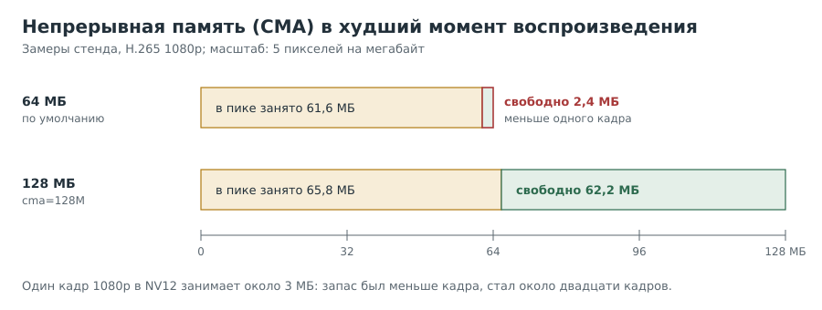

# Глава 9. Память для видео: CMA

Однажды проигрывание упало с сообщением «Not enough memory to allocate source buffers».
При этом `free` показывал сотни свободных мегабайт. Эта глава о памяти, которая кончается
раньше, чем память вообще.

Рецепт 9.5 о том же сообщении на втором стенде, где сбой оказался другим по характеру:
редким, плавающим и не связанным с явной нехваткой памяти.

---

## Рецепт 9.1. Понять, зачем видео особая память

**Задача.** Разобраться, почему декодеру мало «просто свободной памяти».

**Решение.** Запомнить одно различие:

- Процессору достаточно, чтобы память *выглядела* непрерывной: страницы по 4 КБ могут
  лежать где угодно, их склеивает блок управления памятью.
- Видеоблоку, дисплею и многим другим устройствам часто нужна память, непрерывная
  **физически**. Кадр 1080p в NV12 это около 3 МБ одним куском.

Для таких кусков ядро заранее откладывает область **CMA** (Contiguous Memory Allocator).
Пока устройства её не просят, ядро может отдавать её под сменные данные, но устройства
могут получить только то, что в ней есть.

**Подводные камни.** Свободная память в `free` и свободная CMA это разные вещи.

---

## Рецепт 9.2. Узнать, сколько CMA есть

**Задача.** Получить размер области и её свободную часть.

**Решение.**

```
[плата]
grep Cma /proc/meminfo
cat /proc/cmdline | tr ' ' '\n' | grep -i cma
```

Ответ стенда до настройки:

```
CmaTotal:  65536 kB
CmaFree:   46780 kB
(в параметрах ядра cma= нет)
```

**Как это работает.** 64 МБ это размер по умолчанию, заданный при сборке ядра. Уже без
видео занято 18–26 МБ: под них уходят, по нашей версии, буферы экрана консоли и
композитора.

---

## Рецепт 9.3. Измерить, сколько CMA нужно на самом деле

**Задача.** Узнать минимум свободной CMA *во время* воспроизведения.

**Решение.** Опрашивать `/proc/meminfo` в фоне, пока идёт проигрывание, и сохранить
минимум. Фрагмент скрипта (целиком в [приложении](12-appendix.md#скрипты)):

```
( while :; do grep CmaFree /proc/meminfo; sleep 0.3; done ) > "$HOME/test/cma-samples.tmp" &
S=$!
# ... проигрывание ...
kill $S
tr -s " " < "$HOME/test/cma-samples.tmp" | cut -d" " -f2 | sort -n | head -n 1
```

Результат стенда при 64 МБ:

| Файл | Минимум свободной CMA |
|---|---|
| 8 бит 1080p | 2,4 МБ |
| 10 бит 1080p | 2,7 МБ |
| 10 бит 1080p (повтор) | 5,5 МБ |
| 8 бит 1440x1080@60 | 6,7 МБ |

**Как это работает.** Запас в один-два кадра. Стоит чему-то занять на пару мегабайт
больше (остатки прошлого запуска, лишний буфер), и декодер не получает память.
Наш единственный сбой случился как раз при запуске файлов подряд без паузы.

**Подводные камни.** Тест с паузой между запусками сбой не воспроизвёл. Пауза давала памяти
освободиться и **скрыла** причину. Повторяйте условия сбоя, а не «примерно похожие».

---

## Рецепт 9.4. Увеличить CMA правильно

**Задача.** Поднять размер области и не сделать систему незагружаемой.

**Решение.**

1. Убедиться, что загрузочный скрипт передаёт ядру параметры из `armbianEnv.txt`:

```
[плата]
grep -n extraargs /boot/boot.cmd
```

В ответе должна быть строка `setenv bootargs ...` с `${extraargs}`.

2. Сохранить копию, добавить перевод строки в конец файла, если его нет, и дописать
   параметр в `/boot/armbianEnv.txt`:

```
[плата]
sudo cp /boot/armbianEnv.txt ~/armbianEnv.txt.bak
sudo sed -i -e '$a\' /boot/armbianEnv.txt
printf 'extraargs=cma=128M\n' | sudo tee -a /boot/armbianEnv.txt
tail -n 3 /boot/armbianEnv.txt
sudo reboot
```

3. Проверить после перезагрузки:

```
[плата]
cat /proc/cmdline | tr ' ' '\n' | grep -i cma
grep Cma /proc/meminfo
free -m
```

**Как это работает.** `boot.cmd` собирает параметры ядра из переменных, и `extraargs`
среди них. `sed -i -e '$a\'` добавляет перевод строки, только если его нет: иначе новая
строка приклеилась бы к последней и сломала обе. На стенде после перезагрузки
`CmaTotal` стал 131 072 kB, а общий объём памяти (969 МБ) не изменился.



| Файл | Минимум свободной CMA при 128 МБ |
|---|---|
| 8 бит 1080p | 72,5 МБ |
| 10 бит 1080p | 62,2–64,2 МБ |
| 8 бит 1440x1080@60 | 72,4 МБ |

Пик занятости 57–67 МБ, запас примерно вдвое. Для 1080p этого достаточно.

**Подводные камни.**
- На некоторых платах `armbianEnv.txt` не читается вовсе. Проверка шага 1 обязательна.
- Если плата не загрузится, карту можно поправить на другом компьютере: копия лежит в
  домашней папке на той же карте.
- Для 4K кадр втрое тяжелее; 128 МБ может не хватить.

---

## Рецепт 9.5. Плавающий сбой памяти: проверить, поймать, пережить

**Задача.** Сбой `Not enough memory to allocate source buffers` случается редко и не
повторяется по заказу. Исключить очевидные причины, попробовать поймать его и сделать так,
чтобы плеер его переживал.

**Решение.**

1. Убедиться, что устройство никто не держит:

```
[плата]
sudo fuser -v /dev/video0 /dev/media0 2>&1
ps -eo pid,stat,etime,cmd | grep -E 'gst|ffmpeg|timeout' | grep -v grep
```

2. Проверить, не занимает ли CMA файловый кеш:

```
[плата]
grep CmaFree /proc/meminfo
sync; echo 1 | sudo tee /proc/sys/vm/drop_caches
grep CmaFree /proc/meminfo
```

3. Посмотреть, какими кусками свободна CMA:

```
[плата]
sudo grep -E 'Free pages count| CMA ' /proc/pagetypeinfo
```

4. Гонять короткие запуски, пока сбой не случится, и в момент сбоя сохранить журналы
   (скрипт `catch-fail.sh` в [приложении](12-appendix.md#скрипты)).
5. В плеере повторять запуск при этом сбое (скрипт `play-retry.sh` там же).

Ответы второго стенда:

| Проверка | Результат |
|---|---|
| Частота сбоя | 2 раза примерно из 75 запусков: один на 1080p, один на 1920x800 |
| Держит ли кто-то устройство | нет |
| `drop_caches` | `buff/cache` упал со 116 до 33 МБ, а `CmaFree` не изменился (54 844 → 54 848 кБ) |
| Свободная CMA по кускам | сумма ровно равна `CmaFree` (38 184 кБ); крупнейшие куски по 4 МиБ, их три |
| 40 запусков подряд по 4 секунды | ни одного сбоя |
| 5 запусков с записью 150 МБ на карту перед каждым | ни одного сбоя |

**Как это работает.**
- Строка `Free pages count` даёт размеры свободных кусков: порядок N это 2^N страниц по
  4 КБ (порядок 10 это 4 МиБ). Кадру нужен один непрерывный кусок 2,2–3,1 МБ, а кадров
  декодер просит 11 (на 1080p в журнале плагина `Try to create 11 buffers`).
- `drop_caches` безвреден: он отбрасывает только кеш, который ядро восстановит. Неизменный
  `CmaFree` после него исключает файловый кеш как объяснение.
- Вывод честный: **причину мы не нашли**. Нехватка свободной CMA сбой не объясняет: при
  первом сбое свободно было около 65 МБ, а удачные запуски шли и при 40. Гипотеза о
  раздробленности свободной памяти не опровергнута, но и не подтверждена.
- Поэтому мы не стали вслепую увеличивать CMA (рецепт 9.4), а сделали повтор. Сбой виден
  сразу при старте, до первого кадра; обёртка повторяет запуск до трёх раз и пишет каждый
  случай в журнал. Так станет видно, как часто он случается на самом деле.

**Подводные камни.**
- На основном стенде сбой случался при запусках подряд без паузы (рецепт 9.3), а на втором
  оба сбоя были **первыми запусками после паузы**, и 40 запусков подряд прошли. Два случая
  ничего не доказывают, но правило то же: повторять условия сбоя точно.
- `CmaFree` между запусками сползал с 88 до 40–55 МБ, хотя декодер свои буферы возвращал.
  Почему, мы не знаем; файловый кеш исключён.
- Каталога `/sys/kernel/debug/cma` в ядре второго стенда нет: отладочный интерфейс CMA из
  документации ядра включается при сборке.
- Шаблон вида `cat /sys/kernel/debug/cma/*/...` от обычного пользователя не раскрывается:
  каталог доступен только root. Нужно `sudo sh -c 'cat ...'`.

---

## Вопросы для самопроверки

1. Почему декодер может не получить память при 700 МБ свободных в `free`?
2. Как узнать размер CMA и задан ли он в параметрах ядра?
3. Почему тест с паузами между запусками не воспроизвёл сбой?
4. Зачем перед правкой `armbianEnv.txt` смотреть `boot.cmd`?
5. Что делает `sed -i -e '$a\'`?
6. После `drop_caches` значение `CmaFree` не изменилось. Что это исключает?
7. Почему на втором стенде вместо увеличения CMA сделали повтор запуска?

## Где почитать

- [Ядро: параметр cma= в списке параметров ядра](https://docs.kernel.org/admin-guide/kernel-parameters.html)
- [Ядро: CMA и его отладочный интерфейс](https://docs.kernel.org/admin-guide/mm/cma_debugfs.html)
- [Armbian: документация](https://docs.armbian.com/)

---

Назад: [Глава 8. Когда виновата версия](08-fixing-gstreamer.md) | Далее: [Глава 10. Звук и синхронность](10-audio-and-sync.md)
