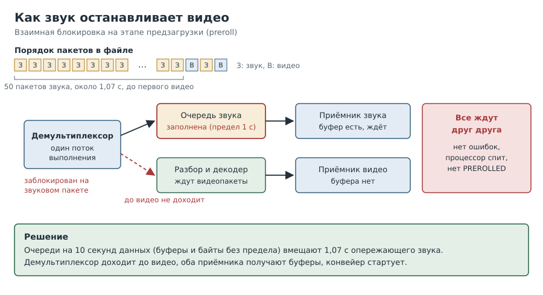
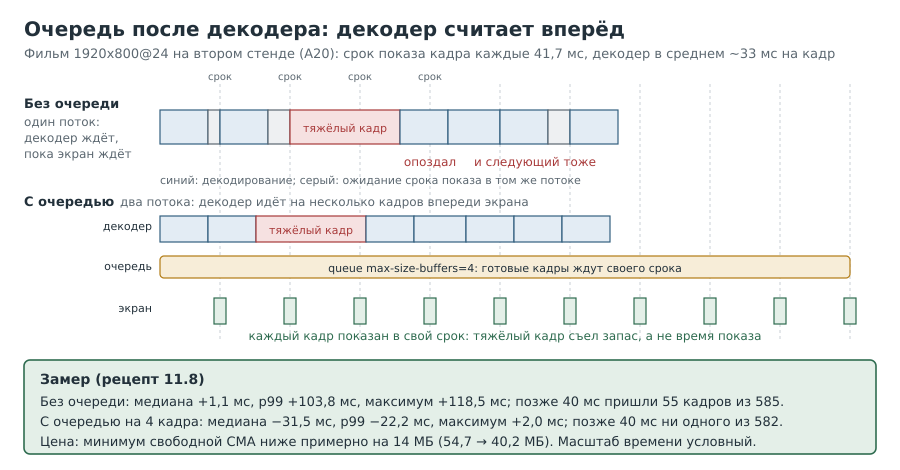

---
aliases:
  - Глава 10
tags:
  - книга/глава
---

# Глава 10. Звук и синхронность

По отдельности всё работало: видео шло, тон по HDMI звучал. Вместе конвейер вставал
намертво, без единой ошибки. Это самая «детективная» глава: в ней мы находим причину
методом исключения и подтверждаем её измерением.

На втором стенде (A20) звук с очередями заработал сразу, зато очередь понадобилась между
декодером и экраном (рецепт 10.8), а звук пришлось сводить из 5.1 в стерео (рецепт 10.9).

---

## Рецепт 10.1. Найти звуковые карты

**Уровень:** ★☆☆ начальный

**Задача.** Узнать, куда можно выводить звук.

**Решение.**

```bash
# [плата]
cat /proc/asound/cards
ls /dev/snd
```

Ответ стенда:

```text
 0 [Codec ]: sun4i-codec - H616 Audio Codec
 1 [HDMI  ]: HDMI - HDMI
```

**Как это работает.** Карта 1 это звук по HDMI, его мы и используем. В ALSA устройство
задаётся как `hw:карта,устройство` или `plughw:карта,устройство`. Вариант `plughw`
сам подгоняет частоту и формат под то, что примет железо, поэтому для проверок он удобнее.

---

## Рецепт 10.2. Проверить звук тоном

**Уровень:** ★☆☆ начальный

**Задача.** Убедиться, что звук доходит до динамиков.

**Решение.**

```bash
# [плата]
sudo apt install gstreamer1.0-alsa alsa-utils
gst-launch-1.0 audiotestsrc wave=sine freq=440 num-buffers=200 ! audioconvert ! audioresample \
  ! alsasink device=plughw:1,0
```

**Как это работает.** `audiotestsrc` генерирует синусоиду 440 Гц, `num-buffers=200` даёт
около пяти секунд. Если тон слышен, тракт до динамиков работает.

> [!warning] Подводные камни
> Если звук заработал после того, как вы собрали набор плагинов из
> главы 8, **пересоздайте набор**: иначе в нём не будет `alsasink`.

---

## Рецепт 10.3. Понять, как конвейер стартует

**Уровень:** ★★☆ средний

**Задача.** Разобраться, почему два исправных куска вместе могут не работать.

**Решение.**



**Как это работает.** Перед воспроизведением GStreamer проходит **предзагрузку** (preroll):
каждый приёмник должен получить хотя бы один буфер. Пока все не получили, конвейер не
переходит в воспроизведение, а приёмник, уже получивший буфер, **ждёт**, удерживая поток
данных.

Демультиплексор читает файл подряд и одним потоком раздаёт пакеты в обе ветки. Если в
файле звук идёт заметно раньше видео:

1. звуковой приёмник получает первый буфер и ждёт;
2. следующий звуковой пакет некуда деть, демультиплексор блокируется на нём;
3. до видеопакетов он не доходит, видеоприёмник не получает буфер;
4. конвейер ждёт вечно, процессор спит, ошибок нет.

Очереди (`queue`) между демультиплексором и ветками развязывают их, но у очереди есть
предел. Если звук опережает видео сильнее, чем помещается в очередь, блокировка
возвращается.

---

## Рецепт 10.4. Найти виновника методом исключения

**Уровень:** ★★★ продвинутый

**Задача.** Выяснить, какая часть конвейера вызывает остановку, не гадая.

**Решение.** Прогнать варианты, меняя по одной детали. Скрипт с функцией `run` есть в
[приложении А](13-appendix-a-scripts.md). Результаты стенда:

| Вариант | Что в конвейере | Предзагрузка |
|---|---|---|
| A | Только видео | да |
| B | Видео с очередью | да |
| C | Видео + звук (AAC) в пустышку | **нет** |
| D | Видео + звук на HDMI | **нет** |
| E | Видео и звук, обе ветки с очередями | **нет** |
| F | Только звук | да |
| G | Видео + сырой звук без декодера | **нет** |
| H | То же с очередями | **нет** |
| I | Видео + звук после `aacparse` | **нет** |
| M | Сырое видео + сырой звук, ни парсера, ни декодера | **нет** |
| N | То же плюс `h265parse` | **нет** |
| J | Видео + звук с **безразмерной** очередью | **да** |

**Как это работает.** Читается снизу вверх. M показывает, что ни декодер, ни парсер, ни ALSA
не виноваты: встаёт даже самый простой граф. J показывает, что лечится очередью без
предела. Значит, звук в файле опережает видео больше, чем вмещает стандартная очередь.

> [!warning] Подводные камни
> Мы потратили несколько попыток, подозревая композитор, HDMI-звук и
> очереди. Каждую версию снимал один вариант из таблицы. Метод исключения быстрее, чем
> кажется.

---

## Рецепт 10.5. Измерить опережение звука

**Уровень:** ★★☆ средний

**Задача.** Подтвердить версию числом.

**Решение.** Рецепт 2.5 на сервере. Стенд: первый видеопакет на 51-й строке с меткой
1,12 с, то есть 50 пакетов звука по ~21 мс, около **1,07 с** опережения.

Предел стандартной очереди посмотрите сами:

```bash
# [плата]
gst-inspect-1.0 queue | grep -A2 -E 'max-size-(time|buffers|bytes)'
```

**Как это работает.** По документации очередь по умолчанию держит не больше секунды
данных, 200 буферов или 10 МБ, смотря что наступит раньше. 1,07 с больше 1 с: звуковая очередь заполнилась,
и всё встало. Совпадение числа с поведением и есть подтверждение.

---

## Рецепт 10.6. Рабочий конвейер со звуком

**Уровень:** ★★☆ средний

**Задача.** Проиграть фильм со звуком.

**Решение.**

```bash
Q="queue max-size-buffers=0 max-size-bytes=0 max-size-time=10000000000"
gst-launch-1.0 filesrc location="$1" ! matroskademux name=d \
  d.video_0 ! $Q ! h265parse ! v4l2slh265dec ! fpsdisplaysink text-overlay=false video-sink=waylandsink \
  d.audio_0 ! $Q ! aacparse ! faad ! audioconvert ! audioresample ! alsasink device=plughw:1,0
```

(Запуск через `cage` и с переменными из главы 8, целиком в
[приложении А](13-appendix-a-scripts.md).)

Ответ стенда, 10 бит 1080p со звуком:

```text
last-message = rendered: 1497, dropped: 0, current: 25.02, average: 24.57
Got EOS from element "pipeline0".
real 1m2.468s   user 0m10.545s   sys 0m6.785s
```

Звук синхронный, кадры не теряются, около 28% одного ядра.

**Как это работает.** Очереди на 10 секунд данных без ограничений по числу буферов и
байтам. Для видео 14 Мбит/с это порядка 17 МБ памяти: на плате с 1 ГБ это немного.
Ветки ссылаются на площадки демультиплексора по именам `video_0` и `audio_0`. `faad`
это декодер AAC из `gstreamer1.0-plugins-bad`. Если его нет, можно взять `avdec_aac` из
`gstreamer1.0-libav` (на стенде не проверяли).

> [!warning] Подводные камни
> Наши тестовые файлы мы сделали сами `libx265` с заглядыванием
> вперёд, отсюда и опережение звука. Настоящие фильмы бывают перемешаны ровнее, но очередь
> с запасом нужна плееру в любом случае.

---

## Рецепт 10.7. Почему не `gst-play-1.0`

**Уровень:** ★☆☆ начальный

**Задача.** Понять, можно ли обойтись готовым плеером.

**Решение.** `gst-play-1.0` лежит в пакете `gstreamer1.0-plugins-base-apps` (не в
`gstreamer1.0-tools`). На нашем файле он остановился на `0:00:00.0` без ошибок. Причину
мы не разбирали; возможно, это та же блокировка с его стандартными очередями. Для
проверок мы пользуемся явным конвейером.

---

## Рецепт 10.8. Развязать декодер и экран очередью

**Уровень:** ★★☆ средний

**Задача.** Средняя частота кадров в норме, а картинка дёргается. Найти и убрать причину.

**Решение.** Измерить опоздание каждого кадра (рецепт 11.8) без очереди и с очередью на
4 кадра между декодером и приёмником (скрипт `run-lat.sh` в
[приложении А](13-appendix-a-scripts.md)):

```bash
# [плата]
$HOME/run-lat.sh lat1 $HOME/film_test.mp4 25 ''
$HOME/run-lat.sh lat2 $HOME/film_test.mp4 25 'queue max-size-buffers=4 max-size-time=0 max-size-bytes=0 !'
```

Ответ второго стенда (фильм 1920x800@24, `skip-vsync=true`, `qos=false`):

| | Медиана | p90 | p99 | Максимум | Позже 40 мс |
|---|---|---|---|---|---|
| без очереди | +1,1 мс | +36,7 мс | +103,8 мс | +118,5 мс | 55 из 585 |
| с очередью на 4 кадра | −31,5 мс | −24,7 мс | −22,2 мс | +2,0 мс | 0 из 582 |

Плюс значит «кадр опоздал», минус значит «пришёл заранее и ждал срока».

**Как это работает.** Без элемента `queue` декодер и приёмник работают в одном потоке
выполнения: пока `kmssink` ждёт срока показа очередного кадра, следующий не декодируется.
Запас декодера (около 25%, рецепт 6.7) нельзя накопить впрок, и каждый тяжёлый кадр
приходит с опозданием. Очередь даёт декодеру свой поток: он считает на несколько кадров
вперёд, а приёмник берёт готовые. Цена: несколько лишних кадров в CMA; минимум свободной
CMA снизился примерно на 14 МБ (с 54,7 до 40,2 МБ).



> [!warning] Подводные камни
> - Очередь **перед** декодером (на сжатых данных) эту задачу не решит: декодер и приёмник
>   останутся в одном потоке. Новый поток в GStreamer начинается на выходе `queue`.
> - Кадры в очереди лежат в буферах декодера. Если пул декодера мал, очередь просто не
>   заполнится; смотрите и опоздания, и CMA.
> - Ощущение «стало плавнее» здесь совпало с цифрами, но записывайте именно цифры
>   (рецепт 11.2).

---

## Рецепт 10.9. Звук AC-3 5.1 на стереомонитор по HDMI

**Уровень:** ★★☆ средний

**Задача.** Вывести многоканальный звук фильма на монитор с двумя динамиками.

**Решение.** Поставить вывод ALSA и декодер AC-3, пересоздать набор плагинов (рецепт 8.4),
проверить тоном:

```bash
# [плата]
sudo apt install gstreamer1.0-alsa gstreamer1.0-libav
$HOME/make-gst-mix.sh
export GST_REGISTRY=$HOME/test/gst-registry-mix.bin GST_PLUGIN_SYSTEM_PATH_1_0=$HOME/gst-mix
gst-inspect-1.0 2>/dev/null | grep -iE 'alsasink|avdec_ac3'
gst-launch-1.0 audiotestsrc wave=sine freq=440 volume=0.2 num-buffers=150 ! audioconvert \
  ! audioresample ! alsasink device=plughw:0,0
```

Ветка звука в конвейере (рядом с веткой видео из рецепта 7.7):

```text
d.audio_0 ! queue max-size-buffers=0 max-size-bytes=0 max-size-time=2000000000 ! avdec_ac3 \
  ! audioconvert ! audio/x-raw,channels=2 ! audioresample ! alsasink device=plughw:CARD=sun4ihdmi,DEV=0
```

Скрипт целиком (`play.sh`) в [приложении А](13-appendix-a-scripts.md). Ответ второго стенда:
`avdec_ac3` пришёл из `gstreamer1.0-libav`; 40 секунд фильма 1920x800 со звуком AC-3 5.1
(448 кбит/с) прошли синхронно, без ошибок в журнале; `user` 7,0 с + `sys` 2,1 с за 40 с,
около 23% одного ядра.

**Как это работает.**

- `avdec_ac3` декодирует AC-3 процессором, а фильтр `audio/x-raw,channels=2` после
  `audioconvert` заказывает сведение 5.1 в стерео.
- Устройство задано по имени карты (`CARD=sun4ihdmi`), а не по номеру: номера зависят от
  порядка, в котором ядро нашло карты. Имя карты стоит в квадратных скобках в
  `cat /proc/asound/cards`.
- Без звука вывод видео стоил меньше 1% ядра, со звуком около 23%. По нашей версии, почти
  всё это декодирование и сведение звука.
- Очереди по 2 секунды сразу за демультиплексором развязывают ветки (рецепт 10.3). На этом
  файле их хватило.

> [!warning] Подводные камни
> - Первый запуск после перезагрузки стартовал на 2–3 секунды дольше (по строке прогресса
>   `gst-launch`), и звук был слегка искажён; второй запуск прошёл чисто. Наша версия: в
>   первую минуту после загрузки процессор ещё занят (`Load: 113%` в баннере), а файлы
>   читаются с карты без кеша. Плеер-службу лучше запускать не сразу после загрузки.
> - После установки пакетов набор плагинов нужно пересоздать (рецепт 8.4), иначе
>   `alsasink` и `avdec_ac3` в нём не появятся.

---

## Вопросы для самопроверки

1. Почему конвейер может стоять без ошибок и без нагрузки на процессор?
2. Какой вариант таблицы доказывает, что декодер не виноват?
3. Как одной командой измерить, насколько звук опережает видео?
4. Почему безразмерная очередь лечит проблему, а стандартная нет?
5. Чем `plughw:1,0` удобнее `hw:1,0` для проверок?
6. Почему очередь против дёрганья ставят после декодера, а не перед ним?
7. Зачем `audio/x-raw,channels=2` после `audioconvert`?

## Где почитать

- [GStreamer: queue](https://gstreamer.freedesktop.org/documentation/coreelements/queue.html)
- [GStreamer: состояния и предзагрузка](https://gstreamer.freedesktop.org/documentation/additional/design/states.html)
- [GStreamer: alsasink](https://gstreamer.freedesktop.org/documentation/alsa/alsasink.html)

---

Назад: [Глава 9. Память CMA](09-cma.md) | Далее: [Глава 11. Методика](11-method.md)
