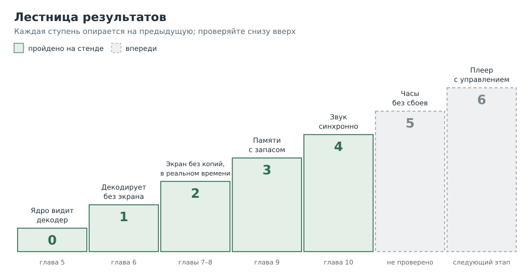
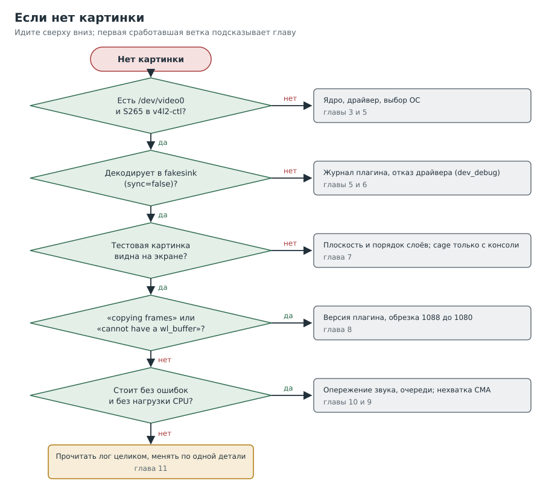

---
aliases:
  - Глава 11
tags:
  - книга/глава
---

# Глава 11. Методика: как понять, что достигнуто

Предыдущие главы учили отдельным приёмам. Эта учит порядку: какие ступени нужно пройти,
чем измерять каждую и как не потерять день на собственных ошибках. Здесь собраны и все
грабли, на которые мы наступили.

---

## Рецепт 11.1. Идти по лестнице, а не прыгать

**Уровень:** ★☆☆ начальный

**Задача.** Понимать, где вы находитесь и что проверять дальше.

**Решение.**



| Ступень | Вопрос | Чем проверить | Где в книге |
|---|---|---|---|
| 0 | Видит ли ядро декодер? | `dmesg`, `/dev/video0`, `v4l2-ctl` | Глава 5 |
| 1 | Декодирует ли без экрана? | `fpsdisplaysink` в `fakesink`, `sync=false` | Глава 6 |
| 2 | Идёт ли на экран в реальном времени без копий? | `average`, `dropped`, `(user+sys)/real`, caps `DMABuf` | Главы 7–8 |
| 3 | Хватает ли памяти с запасом? | минимум `CmaFree` при проигрывании | Глава 9 |
| 4 | Идёт ли звук синхронно? | глаз и ухо, `Got EOS`, `rendered` | Глава 10 |
| 5 | Стабильно ли часами? | длительный прогон, температура | не пройдена |
| 6 | Управляется ли как плеер? | пауза, перемотка, связь с Jellyfin | не пройдена |

**Как это работает.** Каждая ступень опирается на предыдущую. Если ступень 1 не пройдена,
бессмысленно ловить ошибки вывода на экран: их причина ниже.

На втором стенде ступени 0–4 пройдены другим путём: прямой вывод на плоскость (рецепт 7.7)
и звук AC-3 по HDMI (рецепт 10.9). Ступень 3 там с оговоркой: редкий сбой памяти не
объяснён (рецепт 9.5).

---

## Рецепт 11.2. Снимать метрики, а не впечатления

**Уровень:** ★☆☆ начальный

**Задача.** Сформулировать результат так, чтобы его можно было повторить.

**Решение.** Для каждого прогона записывать:

| Метрика | Откуда | Норма для просмотра |
|---|---|---|
| `average` | `fpsdisplaysink`, `last-message` | равна частоте файла |
| `dropped` | там же | 0 |
| `rendered` | там же | растёт; в конце равна числу кадров |
| Нагрузка | `(user + sys) / real` из `time` | заметно меньше 100% одного ядра |
| `Got EOS` | лог `gst-launch` | есть, если дошли до конца |
| Минимум `CmaFree` | опрос `/proc/meminfo` | заметно больше нуля |
| Опоздание кадров: p99 и число опозданий больше периода | `basesink:5`, рецепт 11.8 | кадры приходят заранее, p99 меньше нуля |
| Синхронность | человек | «звук совпадает с картинкой» |

> [!warning] Подводные камни
> Фразу «картинка есть» без лога нельзя считать результатом. Однажды
> нам прислали «картинка есть» вместе с логом, у которого время изменения оказалось на час
> старше: проверочный запуск лог не записал.
>
> ```bash
> # [плата]
> ls -l --time-style=full-iso ~/test/*.log; date
> ```

---

## Рецепт 11.3. Если нет картинки

**Уровень:** ★☆☆ начальный

**Задача.** Быстро сузить поиск.

**Решение.**



---

## Рецепт 11.4. Правила отладки, которые сэкономили бы нам часы

**Уровень:** ★☆☆ начальный

1. **Меняйте одну деталь за раз.** Таблица вариантов в главе 10 решила то, что не решили
   четыре догадки.
2. **Проверяйте результат, а не лог.** Число кадров в файле, а не хвост ошибок
   (рецепт 2.6).
3. **Читайте лог целиком.** Наши `head -n 3` и `cut -c1-220` дважды отрезали именно
   нужную строку.
4. **Повторяйте условия сбоя точно.** `sleep 3` между запусками скрыл нехватку памяти.
5. **Сверяйте опции с установленной версией.** `cage -h`, `gst-play-1.0 --help`,
   `gst-inspect-1.0 элемент`. Онлайн-справка бывает от другой версии.
6. **Не верьте названиям.** Файл «main10» был 8-битным.
7. **Записывайте гипотезы как гипотезы.** Пока опыт не подтвердил, это версия.
8. **Предсказывайте число до замера.** Потолок 46 Мпикс/с дал прогноз около 22 кадров/с
   на 1080p, замер дал 22,05 (рецепт 6.7). Сбывшийся прогноз подтверждает модель,
   несбывшийся учит.
9. **Спрашивайте ядро, а не только программу.** `Invalid argument (22)` у `kmssink` ничего
   не объяснял, отладка DRM назвала поле и числа (рецепт 7.8).
10. **Не доверяйте среднему.** 24,0 кадра/с при дёрганой картинке: смотрите распределение
    опозданий (рецепт 11.8).
11. **Один снимок ничего не доказывает.** Частота видеоблока в простое, одно значение
    `CmaFree`: нужен ряд с метками времени.

---

## Рецепт 11.5. Грабли

**Уровень:** ★☆☆ начальный

| Что случилось | Почему | Как избежать |
|---|---|---|
| Вывод `fpsdisplaysink` пропал | буфер вывода погиб при убийстве `timeout` | `stdbuf -oL` |
| `ffprobe` отказался от двух файлов | один вход за вызов | цикл |
| `cage: invalid option -- 'D'` | опция из другой версии | `cage -h` |
| `gst-play-1.0: command not found` | он в `gstreamer1.0-plugins-base-apps` | проверить пакет по списку файлов |
| `cage` завис после запуска по SSH | нет доступа к экрану | только с консоли; `pkill -9 -f 'cage --'` |
| `GST_PLUGIN_PATH` не подменил плагин | вытеснение по имени в реестре | набор в `GST_PLUGIN_SYSTEM_PATH_1_0` |
| Пропал `alsasink` | набор плагинов собран до установки пакета | пересоздать набор |
| Сбой памяти не повторился | пауза между запусками | повторять без пауз |
| Строка `^[[200~...` и «command not found» | обрывки вставки в скобках | повторить команду |
| Новая строка приклеилась к старой | в файле не было перевода строки в конце | `sed -i -e '$a\'` перед дописыванием |
| Вывод «завис» на `Pipeline is PREROLLING` | вывод скопирован, пока команда ещё шла | дождаться конца `timeout` |
| `find /proc/device-tree` ничего не нашёл | это символическая ссылка | `find /proc/device-tree/ ...` |
| Ряд `CmaFree` потерял порядок | `sort -u` | метка времени `date +%T` в каждой строке |
| Предложенная правка таблицы ничего бы не дала | колонку перезаписывает код | читать функцию, а не только таблицу |
| `sed '/шаблон/i\...'` ничего не вставил | не выяснили | вставка из файла `sed 'Nr файл'`, проверка `diff -u` |
| После теста экран чёрный | консоль очищена командой | Enter на клавиатуре платы |
| 20 кадров/с на экране при 30 у декодера | `kmssink` сам ждёт vsync | `skip-vsync=true` |
| `average` низкий, `dropped` маленький | декодер пропускает кадры по QoS | `qos=false` для диагностики |
| В среднем 24 кадра/с, а картинка дёргается | декодер и экран в одном потоке | `queue` после декодера |

---

## Рецепт 11.6. Честно записать, что не проверено

**Уровень:** ★☆☆ начальный

**Задача.** Не выдать частичный результат за полный.

**Решение.** На момент написания книги не проверены:

- фильмы из настоящей библиотеки, сделанные разными кодировщиками;
- 4K и HDR;
- многочасовая работа, нагрев;
- правильность цветов против эталона;
- mpv с аппаратным декодированием (на Debian 13 нужна самосборка);
- управление плеером и связь с Jellyfin;
- причина отказа драйвера от синтетического 8-битного потока из `x265enc`;
- на втором стенде: причина редкого сбоя `Not enough memory` и сползания `CmaFree`;
- на втором стенде: что делать с 1080p@24 (декодер даёт около 22 кадров/с);
- на втором стенде: композитный выход;
- на втором стенде: почему монитор однажды погас при входе по SSH (ядро событий HDMI не
  видело);
- на втором стенде: mpv (нужны FFmpeg с `v4l2request` и патченый mpv);
- на основном стенде: прямой путь без композитора на более свежем ядре. В исходниках
  основного ядра у смесителя H616 есть видеослой с `NV12`, а на ядре стенда его не было
  видно (рецепт 0.5).

**Как это работает.** Такой список превращается в план следующих шагов и защищает от
неприятных сюрпризов «а говорили, что работает».

---

## Рецепт 11.7. Развести декодер, часы и экран таблицей запусков

**Уровень:** ★★★ продвинутый

**Задача.** Понять, где теряются кадры: в декодере, в синхронизации по часам или в выводе на
экран.

**Решение.** Прогнать один и тот же файл, меняя по одной вещи: приёмник (`fakesink` или
`kmssink`), синхронизацию по часам и QoS. Скрипт `run-fps2.sh` в
[приложении А](13-appendix-a-scripts.md). Таблица второго стенда (фильм 1920x800@24):

| Запуск | Приёмник | Часы | Прочее | Среднее, кадров/с | `dropped` |
|---|---|---|---|---|---|
| — | `fakesink` | нет | | 30,1 | 0 |
| A | `fakesink` | да | | 24,00 | 0 |
| B | `kmssink` | нет | | 20,2 | 0 |
| C | `kmssink` | нет | `skip-vsync=true` | 28,9 | 0 |
| D | `kmssink` | да | `skip-vsync=true` | 17,9 | 7 |
| E | `kmssink` | да | `skip-vsync=true qos=false` | 24,0 | 0 |

**Как это работает.**

- Первая строка и A: декодер сам держит фильм в реальном времени. Дальше ищем не в нём.
- B против первой строки: вывод на экран срезал потолок с 30 до 20. C показывает, что
  виноваты ожидания vsync (рецепт 7.9).
- D: при синхронизации 17,9 кадра/с, а `dropped` всего 7. Если бы кадры терял приёмник,
  счётчик был бы большим. Значит, кадры терялись **раньше**: приёмник посылал вверх
  сообщения QoS («опаздываю»), и декодер пропускал кадры сам. `fpsdisplaysink` такие
  пропуски не считает.
- E: без QoS дошли все кадры, 24,0 кадра/с. Но картинка дёргалась: часть кадров
  опаздывала (рецепт 11.8). Это вылечила очередь после декодера (рецепт 10.8).

> [!warning] Подводные камни
> - Маленький `dropped` при низком `average` говорит о пропусках выше по течению, а не о том,
>   что всё в порядке.
> - `qos=false` прячет нехватку скорости: видео будет отставать, а не пропускать кадры.
>   Включать его в итоговой настройке можно, только если запас скорости измерен.

---

## Рецепт 11.8. Измерить опоздание каждого кадра

**Уровень:** ★★★ продвинутый

**Задача.** Получить не среднюю частоту, а распределение: насколько рано или поздно каждый
кадр приходит к приёмнику.

**Решение.** Включить отладку базового класса приёмников и посчитать статистику
(целиком это `run-lat.sh` в [приложении А](13-appendix-a-scripts.md)):

```bash
# [плата]
GST_DEBUG=basesink:5 timeout 25 gst-launch-1.0 ... > $HOME/test/lat.log 2>&1
grep -m 3 'clock returned' $HOME/test/lat.log
grep 'clock returned' $HOME/test/lat.log \
  | awk '{j=$NF; s=1; c=substr(j,1,1); if (c=="-") {s=-1; j=substr(j,2)}; split(j,a,":"); print s*(a[1]*3600+a[2]*60+a[3])*1000}' \
  | sort -n \
  | awk '{v[NR]=$1; if ($1>0) l0++; if ($1>20) l20++; if ($1>40) l40++} END {printf "n=%d min=%.1f p50=%.1f p90=%.1f p99=%.1f max=%.1f ms; late>0: %d, >20ms: %d, >40ms: %d\n", NR, v[1], v[int(NR*0.5)], v[int(NR*0.9)], v[int(NR*0.99)], v[NR], l0, l20, l40}'
```

Строки журнала второго стенда:

```text
gst_base_sink_do_sync:<kmssink0> clock returned 1, jitter  0:00:00.002355177
gst_base_sink_do_sync:<kmssink0> clock returned 0, jitter -0:00:00.025331924
```

Итоговая строка (без очереди после декодера):

```text
n=585 min=-40.1 p50=1.1 p90=36.7 p99=103.8 max=118.5 ms; late>0: 298, >20ms: 159, >40ms: 55
```

**Как это работает.**

- Перед показом каждого кадра приёмник ждёт часов. `clock returned 0` с отрицательным
  числом значит, что кадр пришёл заранее и ждал (во второй строке 25 мс). `clock returned 1`
  с положительным значит, что срок уже прошёл: кадр опоздал. Так мы читаем эти строки по
  образцам; исходник `basesink` мы для этого не открывали.
- Первый `awk` переводит время вида `-0:00:00.025331924` в миллисекунды со знаком,
  `sort -n` упорядочивает, второй `awk` печатает перцентили (p90 это значение, которого не
  превышают 90% кадров) и счётчики опозданий.
- Период кадра при 24 кадрах/с 41,7 мс. Опоздание больше периода почти наверняка видно
  глазом, а у нас таких было 55 из 585.

> [!warning] Подводные камни
> - Уровень 5 пишет тысячи строк. Сравнивайте только запуски с одинаковой отладкой.
> - Перцентили по 25 секундам описывают эти 25 секунд; тяжёлые сцены могут дать хуже.

---

## Вопросы для самопроверки

1. На какой ступени вы, если `average` равен частоте файла, но в журнале есть
   `copying frames`?
2. Какие пять чисел достаточно записать после прогона?
3. Почему «картинка есть» без лога это не результат?
4. `dropped: 7`, а `average` 17,9 при нужных 24. Куда делись кадры?
5. Что значит `p99=103.8` в статистике опозданий кадров?

## Где почитать

- [GStreamer: инструменты отладки](https://gstreamer.freedesktop.org/documentation/tutorials/basic/debugging-tools.html)
- [Ядро: отладка медиаподсистемы](https://docs.kernel.org/process/debugging/media_specific_debugging_guide.html)
- [GStreamer: GstBaseSink (синхронизация, QoS, max-lateness)](https://gstreamer.freedesktop.org/documentation/base/gstbasesink.html)

---

Назад: [Глава 10. Звук и синхронность](10-audio-and-sync.md) | Далее: [Глава 12. Практикум на C](12-drm-in-c.md)
